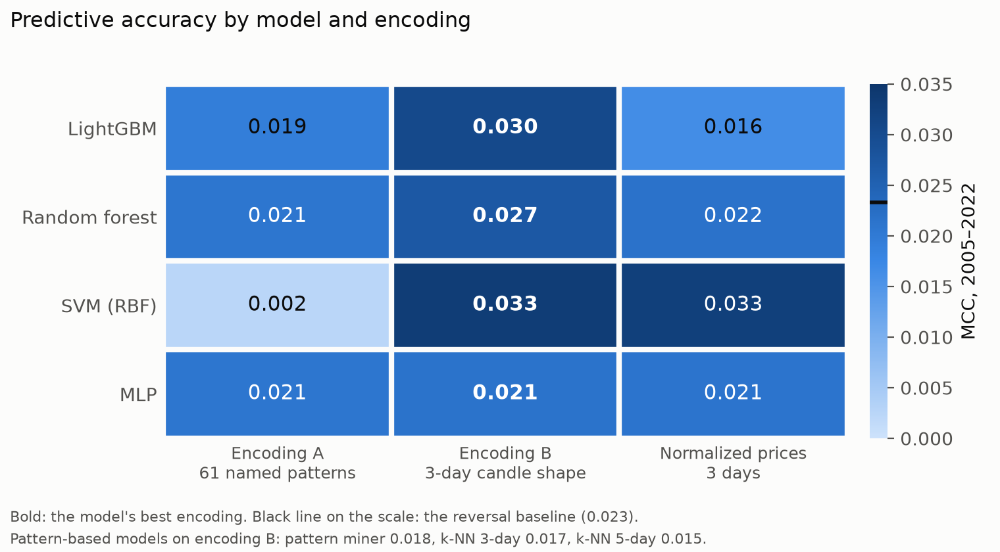
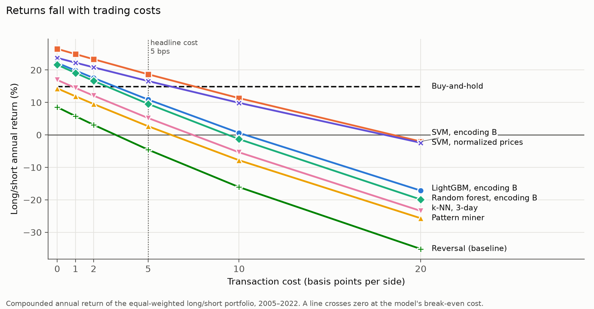
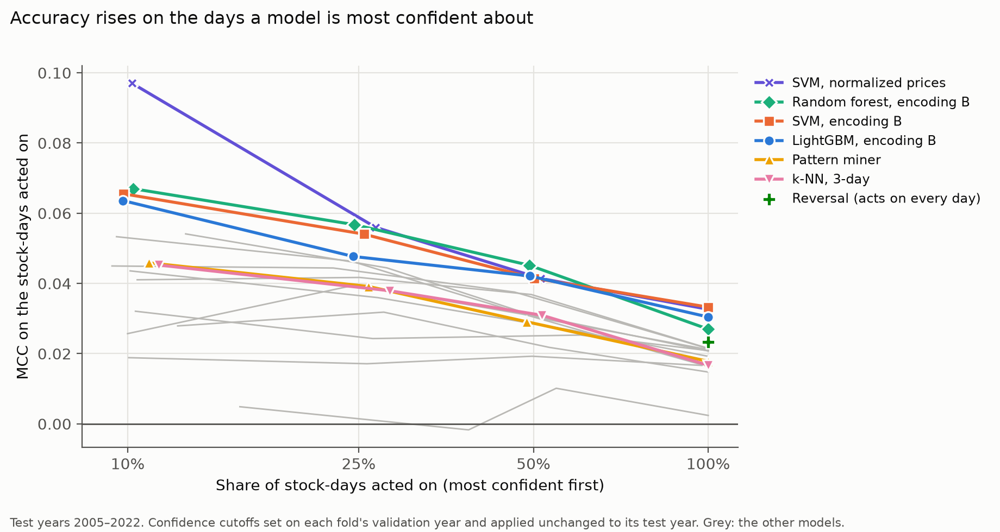
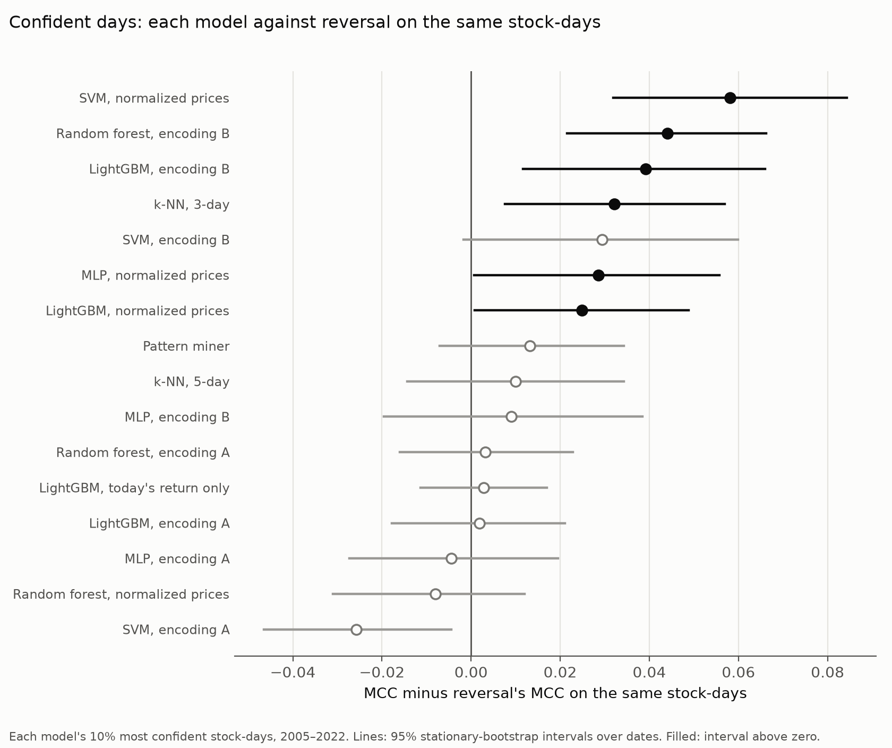
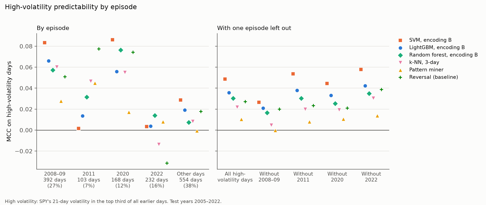

## 9. Results

Sections 9.1–9.7 report the development period: 18 walk-forward test years, 2005–2022, comprising 4,530 trading days and 90,552 labelled stock-days, with every model tuned as described in Section 5.5 (results version v4). Section 9.8 reports the single run on the 2023–2025 holdout, and Section 9.9 the replication of Caginalp and Laurent (1998). Unless stated otherwise, intervals are 95% stationary-bootstrap intervals over dates (Section 8), trading results are net of 5 basis points per side, and "significant" means significant at the 5% level by a Diebold–Mariano test on the daily loss series.

### 9.1 How much can be predicted

Next-day direction is barely predictable from candles. The best model, the support vector machine on the three-day window of encoding B, reaches an MCC of 0.033 (Table 4), a balanced accuracy of 51.3%, and an accuracy of 52.7%, against the 52.2% obtained by always predicting an up day. Small as these numbers are, they are not zero. All fifteen candle-based models except one have MCC intervals that exclude zero, and thirteen of them have a significantly lower classification loss than always predicting an up day (Diebold–Mariano statistics from −2.2 to −4.3; the exceptions are LightGBM on normalized prices, *p* = 0.06, and the support vector machine on encoding A, discussed in Section 9.3).

The simplest baseline is almost as good. The reversal baseline, which predicts that each stock reverses today's move, reaches an MCC of 0.023 [0.013, 0.034]; its mirror image, the previous-day baseline, is correspondingly below chance at −0.025. Reversal is the strongest baseline by a wide margin, and it is the benchmark for every classification comparison that follows.

**Table 4. Development results, 2005–2022** (selected models; all models in the supplementary results)

| Model | MCC [95% interval] | Balanced accuracy | Share predicted up | MCC − reversal [95% interval] |
|---|---|---|---|---|
| SVM, encoding B | 0.033 [0.022, 0.045] | 0.513 | 0.81 | +0.010 [−0.003, 0.023] |
| SVM, normalized prices | 0.033 [0.021, 0.044] | 0.513 | 0.82 | +0.009 [−0.004, 0.022] |
| LightGBM, encoding B | 0.030 [0.020, 0.040] | 0.514 | 0.68 | +0.007 [−0.005, 0.019] |
| Random forest, encoding B | 0.027 [0.016, 0.038] | 0.513 | 0.66 | +0.004 [−0.008, 0.015] |
| *Reversal (baseline)* | *0.023 [0.013, 0.034]* | *0.512* | *0.49* | — |
| MLP, encoding B | 0.021 [0.011, 0.032] | 0.510 | 0.66 | −0.002 [−0.013, 0.009] |
| LightGBM, encoding A | 0.019 [0.011, 0.028] | 0.508 | 0.78 | −0.004 [−0.014, 0.006] |
| Pattern miner | 0.018 [0.009, 0.027] | 0.509 | 0.66 | −0.006 [−0.017, 0.006] |
| k-NN, three-day window | 0.017 [0.007, 0.026] | 0.508 | 0.65 | −0.007 [−0.018, 0.005] |
| LightGBM, today's return only | 0.017 [0.009, 0.025] | 0.507 | 0.74 | −0.007 [−0.016, 0.002] |
| *Always long (baseline)* | *0* | *0.500* | *1.00* | *−0.023* |
| *Previous day (baseline)* | *−0.025* | *0.488* | *0.52* | *−0.048* |

### 9.2 No model beats short-term reversal

No model has a significantly lower classification loss than reversal. The four models with the highest MCC have Diebold–Mariano statistics between −0.37 and +0.22 against it (*p* from 0.71 to 0.95), and every interval for the difference in MCC contains zero (Table 4). Reversal lies inside the 90% Model Confidence Set for the classification loss (*p* = 0.91), together with fourteen of the fifteen candle-based models and LightGBM on today's return; the set excludes only the constant baselines, the previous-day and random baselines, and the support vector machine on encoding A. The SPA test finds no evidence that any model beats reversal (*p* = 0.73). By the criteria fixed in the analysis plan (Section 8), no model demonstrates genuine predictive value beyond the baselines.

The year-by-year results point the same way. LightGBM on encoding B has a positive MCC in 17 of the 18 test years, so its signal is consistent, but it beats reversal in only 8 of them; the support vector machine on encoding B beats reversal in 9 years and the random forest in 10.

MCC and the balanced loss used in the tests (Section 8) rank the support vector machines differently. They have the highest MCC, but they predict an up day on 81–82% of days, and the balanced loss, which counts up and down days equally, penalizes that lean: by it they rank just behind reversal (0.4879 and 0.4884 against 0.4877), while LightGBM and the random forest on encoding B rank just ahead (0.4866 and 0.4873). The differences are a few ten-thousandths, far inside the noise.

### 9.3 What carries the signal

**Candle shape over several days, not named patterns.** Table 5 and Figure 1 compare each machine learning model across the three encodings. Encoding B is the best or equal-best input for every model. The 61 TA-Lib pattern indicators of encoding A give the lowest MCC for three of the four models, and for the support vector machine almost none (0.002). That model predicted an up day on 89% of days: standardizing sparse indicator columns, which are zero on most days, gives the rare non-zero values extreme magnitudes, which distorts the kernel distances. Named patterns add little that the models can use.

**The same information, described two ways.** Encoding B and normalized prices over the same three days contain identical information (Section 4.4). For the support vector machine and the multilayer perceptron, the two give the same MCC (0.033 and 0.033; 0.021 and 0.021). The tree-based models do better with encoding B (LightGBM 0.030 against 0.016; random forest 0.027 against 0.022), plausibly because trees split on one feature at a time, and body and wick lengths are differences of prices that a tree would otherwise have to approximate with many splits. Describing candles by their shape helps models that cannot form such differences themselves; it adds no information.

**More than today's move, less than reversal.** LightGBM given only today's return reaches an MCC of 0.017, against 0.030 when given the full three-day candle window, so the window carries information beyond the size of today's move. But neither beats the one-line reversal rule significantly.

**Pattern-based models trail the machine learning models.** Given the same candles, the pattern miner (0.018) and k-nearest neighbours (0.017 and 0.015 for three- and five-day windows) rank below every machine learning model on encoding B.

**Table 5. MCC by model and encoding, 2005–2022**

| Model | Encoding A (61 named patterns) | Encoding B (3-day shape) | Normalized prices (3 days) |
|---|---|---|---|
| LightGBM | 0.019 | **0.030** | 0.016 |
| Random forest | 0.021 | **0.027** | 0.022 |
| SVM (RBF) | 0.002 | **0.033** | **0.033** |
| MLP | **0.021** | **0.021** | **0.021** |
| Pattern miner (symbolic B) | | 0.018 | |
| k-NN, 3 / 5 days | | 0.017 / 0.015 | |

**Figure 1. MCC by model and encoding, 2005–2022.** Darker cells are more accurate; bold marks each model's best encoding. The black line on the colour scale marks the reversal baseline (0.023), which none of the models beats significantly.

### 9.4 Trading results, costs and market exposure

Before costs, almost every candle-based strategy beats buy-and-hold: long/short returns reach 26.5% a year for the support vector machine on encoding B against 14.9% for an equal-weighted buy-and-hold portfolio of the 22 stocks. Costs change the picture. At 5 basis points per side, only the two support vector machines still earn more than buy-and-hold (18.7% and 16.6% a year; Sharpe ratios 1.25 [0.85, 1.65] and 1.12 [0.73, 1.53], against 0.82), and neither difference is significant (*p* = 0.44 and 0.83). The economic Model Confidence Set contains just these two models and buy-and-hold, and the SPA test finds no evidence that any strategy beats buy-and-hold (*p* = 0.41). Most strategies are significantly worse than buy-and-hold, including the pattern miner (*p* < 0.001).

**Break-even costs** (Table 6 and Figure 2) depend as much on how often a strategy trades as on how accurate it is. The support vector machines trade about 120–130 times a year per stock and break even at about 18 basis points per side; LightGBM and the random forest on encoding B trade about 200 times and break even at 9–10; the pattern miner and k-NN, at about 215 trades, at 6–7; and reversal, which changes position on nearly every day (257 trades a year), at 3.2. Reversal therefore loses money at the headline cost (−4.6% a year) despite having one of the highest MCCs.

**Market exposure.** Because most models predict up days more often than down days, their long/short portfolios are net long, with market betas mostly between 0.31 and 0.61. Regressing each strategy's returns on buy-and-hold's (Section 8) separates the return a strategy earns from the return it gets for being long. Only the two support vector machines and LightGBM on encoding B earn significantly more than their market exposure explains (*t* = 3.38, 2.81 and 2.04). For the long/flat strategy, the comparison with buy-and-hold is mathematically the same test as for long/short: a long/flat position is the average of a long/short position and buy-and-hold, so its difference from buy-and-hold is exactly half the long/short difference, costs included, and the two give identical *p*-values.

**Table 6. Long/short trading results, 2005–2022, 5 bps per side**

| Model | Annual return | Sharpe [95% interval] | Break-even (bps per side) | Market beta | Alpha *t* |
|---|---|---|---|---|---|
| SVM, encoding B | 18.7% | 1.25 [0.85, 1.65] | 18.4 | 0.56 | 3.38 |
| SVM, normalized prices | 16.6% | 1.12 [0.73, 1.53] | 17.9 | 0.53 | 2.81 |
| LightGBM, encoding B | 10.9% | 0.88 [0.45, 1.26] | 10.3 | 0.34 | 2.04 |
| Random forest, encoding B | 9.6% | 0.77 [0.32, 1.18] | 9.4 | 0.34 | 1.46 |
| k-NN, three-day window | 5.2% | 0.47 [−0.01, 0.93] | 7.4 | 0.41 | −0.21 |
| Pattern miner | 2.7% | 0.28 [−0.12, 0.68] | 6.2 | 0.38 | −1.12 |
| *Reversal* | *−4.6%* | *−0.29 [−0.83, 0.16]* | *3.2* | *0.14* | *−2.08* |
| *Buy-and-hold* | *14.9%* | *0.82 [0.42, 1.28]* | *no limit* | *1.00* | — |

**Figure 2. Long/short annual return against transaction cost, 2005–2022.** Each line crosses zero at the model's break-even cost. The dashed line is buy-and-hold; the dotted vertical line marks the headline cost of 5 basis points per side.

### 9.5 The most confident predictions

A model's edge may be concentrated in the days it is most sure about, where the pooled MCC would hide it (Section 5.3). Following the coverage analysis of Section 8, confidence cutoffs set on each fold's validation year were applied unchanged to its test year. For every candle-based model, MCC rises as the model acts on fewer, more confident stock-days (Figure 3). On their 10% most confident stock-days, the support vector machine on normalized prices reaches an MCC of 0.097, the random forest, support vector machine and LightGBM on encoding B 0.064–0.067, and the pattern miner and three-day k-NN 0.046 and 0.045. LightGBM given only today's return stays flat (0.019): knowing only the size of today's move does not identify better days.

Because a model's confident days might simply be days on which reversal works unusually well, reversal was scored on exactly the stock-days each model chose (Figure 4). On their 10% most confident days, six models beat reversal on the same days with intervals above zero: the support vector machine on normalized prices (+0.058 [0.032, 0.084]), the random forest on encoding B (+0.044 [0.022, 0.066]), LightGBM on encoding B (+0.039 [0.012, 0.066]), the three-day k-NN (+0.032 [0.008, 0.057]), and the multilayer perceptron and LightGBM on normalized prices (+0.029 and +0.025, with lower limits of 0.001). Reversal's own MCC on those days (0.013–0.049) was close to its overall level, so the models were not merely choosing days on which reversal works. Trading only on its confident days, the support vector machine on normalized prices earned 19.2% a year (Sharpe 0.89, break-even 10.4 basis points), against −5.9% for reversal on the same days.

This comparison was added after the coverage curves had been seen and the six models were selected because their intervals cleared zero, so it is exploratory. It was therefore registered, before the holdout was unlocked, as the paper's confirmatory hypothesis (Section 9.8).

**Figure 3. MCC on the stock-days each model is most confident about, 2005–2022.** Moving left, each model acts only on its most confident stock-days, using cutoffs set on the fold's validation year. Grey lines are the remaining models. Reversal has no measure of confidence and acts on every day.

**Figure 4. Each model against reversal on its 10% most confident stock-days, 2005–2022.** Points are the difference between the model's MCC and reversal's MCC on the same stock-days, with 95% stationary-bootstrap intervals over dates. Filled points have intervals above zero. This comparison is exploratory; it became the confirmatory test of Section 9.8.

### 9.6 Volatility regimes and episodes

Predictability rises with volatility. Reversal's MCC is 0.017 on low-volatility days, 0.028 on medium and 0.027 on high, and most models follow the same pattern (the support vector machine on encoding B: 0.023, 0.031 and 0.049). Within no regime does any model beat reversal significantly. On low-volatility days, six models are significantly worse than reversal on the balanced loss, including LightGBM and the random forest on encoding A and LightGBM on today's return. On medium- and high-volatility days, no model differs significantly from reversal in either direction.

In trading terms, one result stands out: on high-volatility days, the support vector machine on encoding B beat buy-and-hold significantly (Sharpe 1.66 against 0.63, *p* = 0.03), and the result holds when regimes are defined by the VIX (1.97 against 0.84). It is one of about 96 regime comparisons, however, and would not survive a correction for multiple testing.

**A single episode drives much of the high-volatility advantage.** The 2008–09 financial crisis accounts for 27% of high-volatility days (392 of 1,449), the 2022 bear market for 16%, the 2020 pandemic crash for 12%, the 2011 debt-ceiling crisis for 7%, and scattered days in other years for 38% (Figure 5). Leaving out 2008–09 roughly halves most models' high-volatility MCC (the support vector machine on encoding B from 0.049 to 0.027, LightGBM on encoding B from 0.036 to 0.021, the three-day k-NN from 0.022 to 0.005), while reversal falls less (0.027 to 0.020). Without that one crisis, most models fall below reversal on high-volatility days. The episodes also differ in kind: in 2008–09 and 2020, crashes followed by sharp rebounds, the candle models do best (MCC 0.05–0.10); in 2011 reversal is strongest (0.077); and in 2022, a steady, trending decline, reversal fails (−0.032) and most models are near zero. The support vector machine's trading advantage in turbulent markets also rests mostly on 2008–09, when buy-and-hold had a Sharpe ratio of 0.14: without it, the gap shrinks from 1.03 to 0.33.

**Figure 5. MCC on high-volatility days by episode (left) and with each episode left out (right), 2005–2022.** The models' advantage on high-volatility days rests largely on 2008–09; reversal failed in the steady decline of 2022.

### 9.7 Robustness

**Dead zone.** Removing the dead zone, or doubling it, leaves the conclusions unchanged (Table 7). The same four models rank first, reversal stays near 0.022, and no model beats reversal or buy-and-hold significantly under either setting.

**Per-stock training.** Training one model per stock instead of pooling makes most models worse. LightGBM on encoding B falls from an MCC of 0.030 to 0.013, and the pattern miner and three-day k-NN to 0.013 and 0.013; all three become significantly worse than reversal (*p* ≈ 0.03), and their long/short Sharpe ratios turn negative. Only the support vector machine on normalized prices holds up (0.030). This supports pooling: a single stock provides too few training days, especially for the pattern models.

**Entering at the next day's open.** The largest effect of any check comes from changing the execution assumption. Trading each signal from the next day's open to its close, instead of at the close just observed, cuts the support vector machine on encoding B from a Sharpe ratio of 1.25 to 0.49 and LightGBM on encoding B from 0.88 to 0.10, and turns most strategies unprofitable (break-even costs of 3–10 basis points). No strategy earns significantly more than its market exposure explains (largest alpha *t* = 1.72). Buy-and-hold falls too, from 14.9% to 4.7% a year, because much of these stocks' return accrues overnight. The trading results of Section 9.4 therefore depend on the optimistic assumption of trading at an observed close.

**Table 7. Robustness checks: MCC, 2005–2022**

| Model | Main | No dead zone | Double dead zone | Per-stock training |
|---|---|---|---|---|
| SVM, encoding B | 0.033 | 0.025 | 0.031 | 0.025 |
| SVM, normalized prices | 0.033 | 0.032 | 0.035 | 0.030 |
| LightGBM, encoding B | 0.030 | 0.028 | 0.032 | 0.013 |
| Random forest, encoding B | 0.027 | 0.025 | 0.033 | 0.020 |
| Pattern miner | 0.018 | 0.018 | 0.018 | 0.013 |
| k-NN, three-day window | 0.017 | 0.019 | 0.020 | 0.013 |
| *Reversal* | *0.023* | *0.022* | *0.023* | *0.023* |
| Models beating reversal (Section 8 criteria) | none | none | none | none |

### 9.8 The 2023–2025 holdout

The holdout was unlocked once, after the analysis plan had been frozen and tagged, and run with the frozen pipeline.

**The confirmatory hypothesis was not confirmed.** The plan's primary test asked whether, averaged over the six models of Section 9.5, MCC on each model's 10% most confident stock-days exceeds reversal's MCC on the same days. On the holdout, the average difference was +0.027 [−0.008, 0.062], one-sided *p* = 0.062, so the hypothesis is not rejected at the 5% level. No model passes the secondary per-model tests after the Holm–Bonferroni correction (the smallest uncorrected *p*-value is 0.042, for the random forest on encoding B). As the plan specified in advance, this is reported as inconclusive rather than as evidence against the effect: the holdout's three years gave the test an expected power below 50%.

The positive estimate needs one qualification. On their confident holdout days, the models' own MCC was close to zero (from −0.027 to +0.025), and the difference from reversal is positive mainly because reversal did badly on those days (as low as −0.079). The models did not beat reversal by predicting well; reversal failed.

**The development signal did not carry over.** On all holdout days, every model's MCC lies between −0.017 and +0.009 (Table 8), and reversal's is −0.006. The strongest baseline by MCC was the random one (0.010), and no model has a significantly lower classification loss than it (SPA *p* = 0.97). In trading, 2023–2025 was a strong rising market, in which buy-and-hold had a Sharpe ratio of 2.07, and every long/short strategy was significantly worse than buy-and-hold. All six confident-day strategies lost money.

**Table 8. Development and holdout MCC**

| Model | Development, 2005–2022 | Holdout, 2023–2025 |
|---|---|---|
| SVM, encoding B | 0.033 | 0.006 |
| SVM, normalized prices | 0.033 | 0.005 |
| LightGBM, encoding B | 0.030 | −0.002 |
| Random forest, encoding B | 0.027 | −0.003 |
| Pattern miner | 0.018 | −0.013 |
| k-NN, three-day window | 0.017 | 0.003 |
| *Reversal* | *0.023* | *−0.006* |

### 9.9 Replication of Caginalp and Laurent (1998)

Caginalp and Laurent reported that eight three-day reversal patterns predicted S&P 500 stocks in 1992–1996 with very high significance. We repeated their test on our 22 stocks over 2002–2022, coding the patterns from their definitions, requiring their trend condition, and using their outcome: the close of the pattern's last day against the average of the next three closes (Table 9).

The patterns did not work. Bullish patterns were followed by a rise 51.3% of the time, slightly *below* the 54.0% base rate for days in the same trend (their Z = −2.1), against 71% versus 45% (Z = 36) in the original study; bearish patterns were followed by a fall 46.8% of the time against a base rate of 47.0% (Z = −0.2), against 67% versus 53% (Z = 27). No individual pattern approaches significance on the date-averaged test that allows for signals on the same day moving together (all |*t*| < 1.5), the result holds in both halves of the period, and it is the same with TA-Lib's definitions of the patterns, with or without the trend condition. After costs, every pattern loses money (−4 to −53 basis points per trade).

This is not a failure to detect a real effect. With about 1,500 bullish signals, an effect of the original size would produce a Z statistic of roughly 13 here. The effect itself is absent. Several differences may explain why the original study found it: a five-year sample in a strong bull market, a broader universe including smaller stocks, a significance test that treats every signal as independent, and the tendency of published return anomalies to weaken after publication (McLean & Pontiff, 2016).

**Table 9. Caginalp and Laurent's patterns: original study and replication** (outcome: the average of the next three closes against the pattern's last close)

| | Original, 1992–1996 | Replication, 2002–2022 |
|---|---|---|
| Bullish patterns: success vs base rate | 71% vs 45% (Z = 36) | 51.3% vs 54.0% (Z = −2.1; *t* = −1.4) |
| Bearish patterns: success vs base rate | 67% vs 53% (Z = 27) | 46.8% vs 47.0% (Z = −0.2; *t* = −0.2) |
| Bullish signals | not comparable (≈500 stocks) | 1,506 |
| Mean return per bullish trade, before costs | about 90 bps | −1 bp |

*Z* counts every signal as independent, as in the original study; *t* averages each day's signals first and uses Newey–West standard errors.

### References for this section

- Caginalp, G., & Laurent, H. (1998). The predictive power of price patterns. *Applied Mathematical Finance*, 5(3–4), 181–205.
- McLean, R. D., & Pontiff, J. (2016). Does academic research destroy stock return predictability? *Journal of Finance*, 71(1), 5–32.
