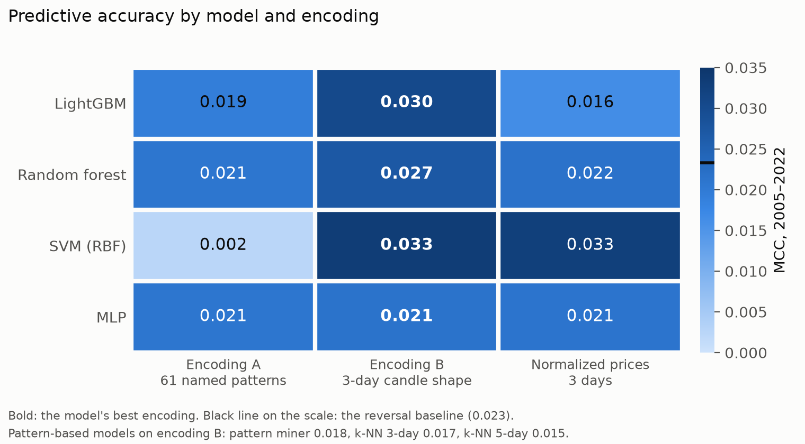
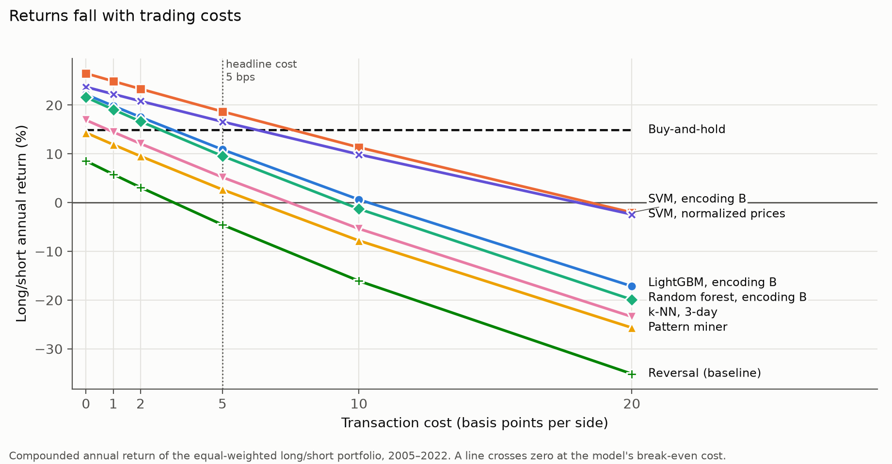
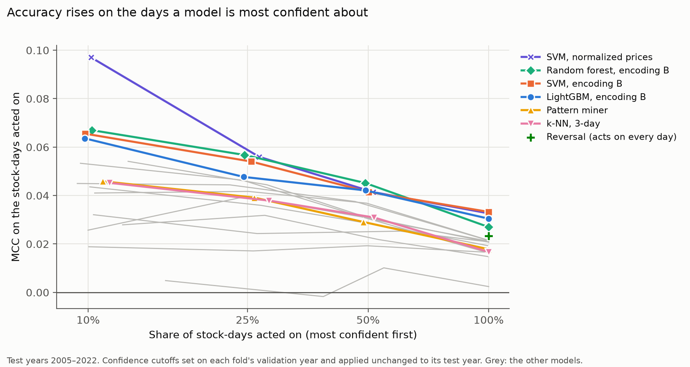
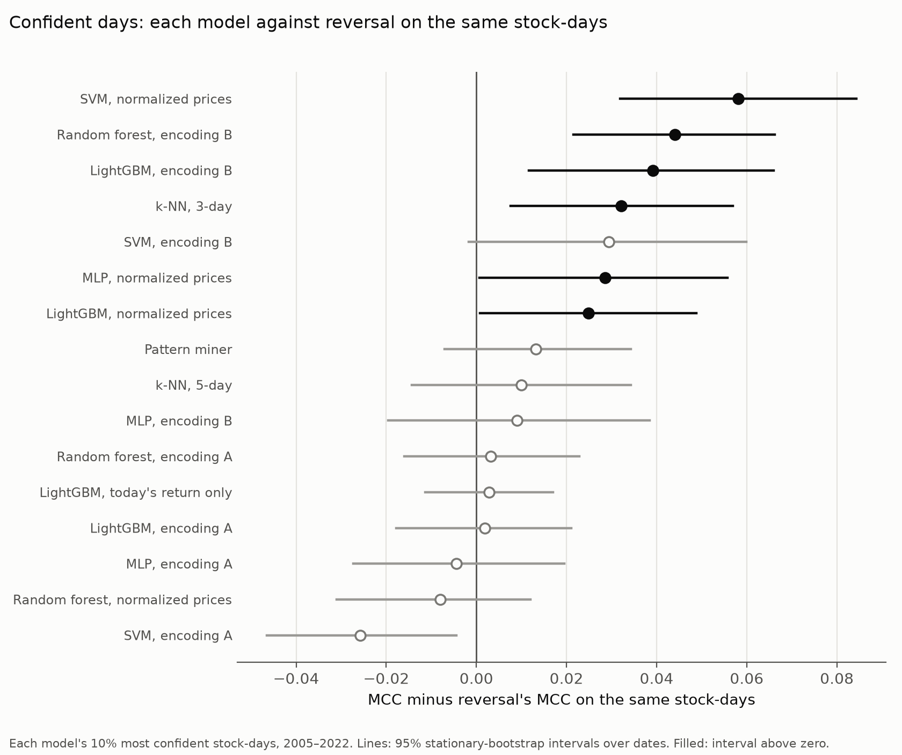
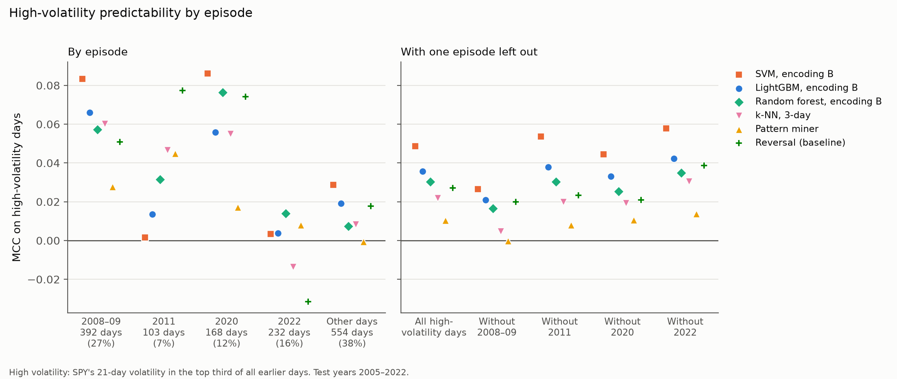

# A Comparative Study of Pattern Mining-Based Models and Machine Learning Algorithms for Candlestick-Based Stock Prediction

[Authors and affiliations — order to be agreed]

## Abstract

Candlestick charts are widely used to forecast short-term stock moves, but the evidence that their patterns predict anything is mixed, and machine learning studies of the same price data rarely test against simple baselines. We compare two pattern-based models, a variable-order pattern miner and k-nearest neighbours, with four machine learning models (LightGBM, random forest, support vector machine and multilayer perceptron) at predicting the next-day direction of 22 large U.S. stocks. Each model is given the same candles in up to three forms: 61 named patterns, continuous candle shape, and normalized prices. Models are evaluated in 18 years of walk-forward tests (2005–2022) against five naive baselines, using tests on daily loss series (Diebold–Mariano tests, the Model Confidence Set and a test for superior predictive ability), transaction costs, and a three-year holdout (2023–2025) used once under a pre-registered analysis plan. Candles carry a small signal: the best models reach a Matthews correlation coefficient (MCC) of 0.033, and thirteen of fifteen candle-based models significantly beat always predicting an up day. None, however, beats a one-line rule that predicts each stock will reverse today's move (MCC 0.023), and no trading strategy significantly beats buy-and-hold after costs. Named patterns are the weakest encoding, and pattern-based models trail the machine learning models. A pre-registered test of whether models beat reversal on their most confident days was not confirmed on the holdout (*p* = 0.062), where every model's MCC was within 0.02 of zero. A replication of Caginalp and Laurent (1998) finds no effect for their eight reversal patterns. On these stocks, what candlesticks predict is almost entirely short-term reversal.

**Keywords:** candlestick patterns; technical analysis; stock direction prediction; machine learning; variable-order Markov models; short-term reversal; model confidence set

## 1. Introduction

A daily candlestick summarizes a stock's trading day in four prices: the open, high, low and close. Candlestick charting holds that particular shapes, and short sequences of them, signal what the price will do next. A long lower wick after a fall is read as buyers returning; a large down day that engulfs the previous up day is read as the end of a rally. These patterns are a standard part of technical analysis, built into charting software and trading libraries, and widely used by traders for short-term decisions.

Whether they work is less clear. Caginalp and Laurent (1998) reported that eight three-day reversal patterns predicted the direction of S&P 500 stocks with very high significance, but most later studies of large U.S. stocks found no value after costs (Marshall et al., 2006; Horton, 2009; Duvinage et al., 2013), while studies of Taiwanese stocks found some patterns profitable (Lu et al., 2012; Lu, 2014). In parallel, machine learning models trained on daily prices have reported accuracy and trading profits well above chance (Krauss et al., 2017; Fischer & Krauss, 2018), including models given candlestick features (Lin et al., 2021a, 2021b). When Fischer and Krauss examined what their networks had learned, however, the stocks they traded showed a short-term reversal profile, and a simple reversal rule explained part of their returns.

That observation points to three gaps in this literature. First, most candlestick patterns describe a move followed by a sign of its reversal, and short-term reversal is a well-documented effect in stock returns (Jegadeesh, 1990; Lehmann, 1990). Yet patterns and models are usually compared with chance or with buy-and-hold, not with a rule that simply predicts each stock will reverse today's move, so a study cannot tell pattern recognition from reversal. Second, pattern-based methods and machine learning methods have not been compared on the same data, labels and costs, so it is unknown whether either approach, or either way of describing candles, is better. Third, signals from different stocks often occur on the same days and move together, and many studies try many patterns or models, so tests that treat every signal as independent, or report only the best result, overstate the evidence (Sullivan et al., 1999; Harvey et al., 2016).

This study addresses these gaps with four questions:

1. Do daily candles predict next-day direction better than naive baselines, and in particular better than short-term reversal?
2. Which works better, pattern-based models or machine learning models, and does it matter how candles are encoded?
3. Does any predictive edge survive transaction costs and realistic execution?
4. Do the development-period findings hold on later data that played no part in building the models?

We predict the next-day direction of 22 large U.S. stocks, two from each sector of the S&P 500, from 2002 to 2025. Two pattern-based models, a variable-order pattern miner that matches exact sequences of candle symbols and *k*-nearest neighbours that matches similar candle shapes, are compared with four machine learning models: LightGBM, a random forest, a support vector machine and a multilayer perceptron. The machine learning models are given the same candles in three forms: the 61 named patterns of the TA-Lib library, a continuous description of each candle's body, wicks and gap over three days, and normalized prices over the same three days. Every model family is tuned with the same budget and evaluated in 18 years of walk-forward tests from 2005 to 2022 against five naive baselines, including the reversal rule. Comparisons are tested on one loss value per day, which combines all 22 stocks' predictions, using Diebold–Mariano tests, the Model Confidence Set and a test for superior predictive ability. The analysis plan was fixed and tagged before a final three-year holdout, 2023–2025, was used once. We also repeat Caginalp and Laurent's test with their own pattern definitions.

The main findings are as follows.

- **Candles carry a small signal, and it is almost all reversal.** The best models reach a Matthews correlation coefficient (MCC) of 0.033, and thirteen of fifteen candle-based models significantly beat always predicting an up day. None is significantly better than the reversal rule (MCC 0.023), over all days or within any volatility regime.
- **Named patterns are the weakest encoding, and pattern-based models trail machine learning.** A three-day window of continuous candle shape gives the best or equal-best results for every machine learning model. The 61 named patterns give the lowest for three of the four. The pattern-based models rank below every machine learning model given the same candles.
- **No strategy beats buy-and-hold after costs.** Before costs, almost every candle-based strategy does. At 5 basis points per side, only the two support vector machines still earn more than buy-and-hold, not significantly, and entering at the next day's open instead of the observed close removes every strategy's significant return beyond its market exposure.
- **The development signal does not survive the holdout.** On 2023–2025, every model's MCC is within 0.02 of zero. A pre-registered test of the most promising development result, that models beat reversal on their most confident days, was not confirmed (*p* = 0.062).
- **The original positive result does not replicate.** With Caginalp and Laurent's definitions and test, their eight patterns show no predictive power on our stocks in 2002–2022.

Section 2.6 sets out the study's contributions relative to earlier work. In brief, it is a controlled comparison of pattern-based and machine learning models on identical data with a reversal baseline, tests designed for correlated signals and many models, and a pre-registered holdout. Its conclusion is negative, and the study was designed so that a negative result would be informative: it shows where apparent candlestick predictability comes from and why earlier studies have disagreed. All code, the analysis plan and the results files are public.

The rest of the paper is organized as follows. Section 2 reviews related work. Section 3 describes the data, Section 4 the candle encodings and prediction target, and Section 5 the models. Sections 6 and 7 describe the validation design and the evaluation metrics, baselines and backtest, and Section 8 the statistical tests. Section 9 reports the results, and Section 10 discusses them, with their limitations.

## 2. Related Work

This study draws on four lines of research: tests of technical trading rules and the statistical problems they raise, tests of candlestick patterns, machine learning studies of stock direction, and the short-term reversal effect. A fifth, smaller literature on variable-order sequence models supplies the pattern miner. This section reviews each in turn and ends with the gaps this study addresses.

### 2.1 Technical analysis and data snooping

Brock, Lakonishok and LeBaron (1992) tested moving-average and trading-range-break rules on the Dow Jones index from 1897 to 1986. Using bootstrap methods to compare the rules' returns with those of standard time-series models, they found strong support for the rules. Sullivan, Timmermann and White (1999) showed why such results need a second look. They applied White's Reality Check, which tests the best rule against the full set of rules that could have been tried, to an expanded version of Brock et al.'s rules. The best rule still produced superior performance in Brock et al.'s sample period, but data snooping was an issue in the following ten years. Park and Irwin (2007) reviewed 95 modern studies of technical trading. Of these, 56 found positive results, 20 negative and 19 mixed. Most, however, were subject to problems in their testing procedures, including data snooping, ex post selection of rules, and difficulty in estimating risk and transaction costs.

Lo, Mamaysky and Wang (2000) brought chart patterns, rather than indicator rules, into a statistical framework. They identified patterns such as head-and-shoulders automatically with kernel regression and compared the distribution of returns after a pattern with the unconditional distribution. Over 1962–1996, several of the patterns provided incremental information. Their comparison of conditional and unconditional distributions is close in spirit to the pattern models in this study, although their patterns are shapes spanning weeks and ours are candles of one to three days.

Later work quantified how far published predictability overstates true predictability. Harvey, Liu and Zhu (2016) argued that, given the hundreds of factors already tested, a new factor should need a *t*-statistic above 3.0 rather than 2.0, and that most claimed findings in financial economics are likely false. Bailey et al. (2014) showed that high backtest performance is easily achieved by trying a relatively small number of strategy configurations, and that the number tried is rarely reported. McLean and Pontiff (2016) studied 97 published predictors of stock returns and found that their returns fell outside the original samples and fell further after publication, consistent with investors learning from academic research. These results shaped the design of this study: a fixed set of models and encodings reported in full, tests that allow for the number of models compared (Section 8), and a holdout set aside before any results were seen (Section 6.4).

### 2.2 Candlestick patterns

Nison (1991) is the standard practitioner reference for candlestick patterns such as the doji, hammer and engulfing patterns in encoding A (Section 4.2). The first large statistical test was by Caginalp and Laurent (1998), who reported that eight three-day reversal patterns predicted the direction of S&P 500 stocks in 1992–1996 with very high significance. Section 9.9 repeats their test on our data.

Most later studies of large U.S. stocks were negative. Marshall, Young and Rose (2006) tested candlestick strategies on the stocks of the Dow Jones Industrial Average from 1992 to 2002, using a bootstrap that generated random open, high, low and close prices, and found no evidence that candlestick strategies create value. Horton (2009) examined 349 stocks and also found little value in candlesticks, contradicting an earlier article. Duvinage, Mazza and Petitjean (2013) tested candlestick rules on 5-minute data for the 30 Dow stocks. About a third of the rules beat buy-and-hold at the conservative Bonferroni level, but only a few remained profitable after trading costs, and trading systems combining the best rules showed no outperformance after costs.

Positive results have come mainly from Taiwan. Lu, Shiu and Liu (2012) found that three bullish two-day reversal patterns were profitable for the stocks of the Taiwan Top 50 Tracker Fund from 2002 to 2008. Lu (2014) found four single-day patterns profitable after transaction costs on Taiwan stocks over 1992–2009. Lu, Chen and Hsu (2015) showed that profitability depends on how the preceding trend is defined and how long positions are held, and that the evidence for candlestick strategies is stronger in more volatile markets.

Three features of this literature matter for the present study. First, results differ by market, period and pattern definition, so a single study can find a strong effect or none. Second, patterns are usually compared with buy-and-hold or with the unconditional return, not with a simple rule that captures the reversal most patterns describe. Third, signals are often tested as independent observations even though many occur on the same days. This study uses fixed pattern definitions, 18 years of walk-forward tests followed by a three-year holdout, a reversal baseline, and tests on daily loss series that combine all of a day's predictions into one observation.

### 2.3 Machine learning for stock direction

Early machine learning studies of market direction used single indices. Kim (2003) applied support vector machines to the daily direction of the Korean composite stock index and found that they outperformed back-propagation neural networks and case-based reasoning. Huang, Nakamori and Wang (2005) forecast the weekly direction of the Nikkei 225 with a support vector machine, which outperformed linear and quadratic discriminant analysis and an Elman neural network.

Later studies used many stocks and longer periods. Krauss, Do and Huck (2017) trained deep neural networks, gradient-boosted trees and random forests on the lagged returns of all S&P 500 stocks from 1992 to 2015, after removing survivorship bias, and generated daily one-day-ahead trading signals. A simple ensemble of the three earned more than 0.45% per day before transaction costs, although profits declined in later years. Fischer and Krauss (2018) applied long short-term memory networks to the same problem and examined which stocks the networks chose to trade. Those stocks had high volatility and a short-term reversal profile, and a simple rules-based reversal strategy explained part of the networks' returns. Gu, Kelly and Xiu (2020) compared machine learning methods for predicting monthly stock returns and found that trees and neural networks performed best, with all methods agreeing on the dominant signals: variations on momentum, liquidity and volatility.

A few studies combine candlesticks with machine learning. Lin et al. (2021a) encoded the relationship between consecutive candles with an "eight-trigram" scheme and trained an ensemble of machine learning models on Chinese stocks from 2000 to 2017, reporting prediction accuracy above 60% for some patterns. Lin et al. (2021b) applied several machine learning methods to two- and three-day candlestick patterns on all Chinese stocks, training on 2000–2014 and testing on 2015–2020, and found one-day-ahead strategies to be profitable. These studies do not compare the machine learning models with pattern-based models on the same data, or with a reversal rule.

Fischer and Krauss's finding is central to the present study. If a model given only prices rediscovers short-term reversal, its accuracy is evidence of reversal rather than of anything new. We therefore include reversal as an explicit baseline and judge every model against it, and we add a model given only today's return (Section 5.4) to measure how much of the candle-based models' accuracy reversal alone can explain.

### 2.4 Short-term reversal

Jegadeesh (1990) found highly significant negative first-order serial correlation in the monthly returns of individual stocks. Lehmann (1990) found that stocks that were winners or losers in one week tend to experience sizeable return reversals the following week. Lo and MacKinlay (1990) showed that such contrarian profits need not come from overreaction: if the returns of some stocks lead those of others, a strategy that sells winners and buys losers can earn positive expected returns even when no stock's returns are negatively autocorrelated, and they found that the returns of large stocks lead those of smaller ones. Because most named candlestick patterns describe a move followed by a sign of its reversal, any predictive power they show must be separated from this effect before it can be credited to the patterns.

### 2.5 Variable-order sequence models

The pattern miner (Section 5.1) treats each stock's candles as a sequence of symbols and predicts from the longest recent run of symbols that has enough history. This is the idea behind variable-order Markov models, which use a long context only where the data support it. Ron, Singer and Tishby (1996) proposed and analysed a learning algorithm for such models, which they called probabilistic suffix automata. Begleiter, El-Yaniv and Yona (2004) compared six prominent algorithms for prediction with variable-order Markov models on proteins, English text and music. Candlestick studies, by contrast, have generally tested fixed lists of named patterns rather than learning from the data which sequences matter.

### 2.6 Contribution

Relative to this literature, the study makes five contributions. First, it compares pattern-based models and machine learning models on identical data, labels, folds, tuning budgets and trading costs, so differences reflect the models rather than the setup. Second, it encodes the same candles three ways (named patterns, continuous candle shape and normalized prices), separating the effect of the encoding from that of the model. Third, it includes short-term reversal as a baseline, so a model is credited only with what it adds to reversal. Fourth, it tests every comparison on daily loss series with tests designed for comparing many forecasts: Diebold–Mariano tests, the Model Confidence Set and the test for superior predictive ability. Fifth, it fixes its analysis plan before using a three-year holdout and repeats Caginalp and Laurent's positive study with that study's own definitions.

## 3. Data

We use daily open, high, low and close prices from Yahoo Finance, retrieved with the yfinance library (version 1.7.0) on September 28, 2026. Prices are adjusted for splits and dividends. The study period runs from January 2, 2002 to December 31, 2025, which starts after U.S. exchanges completed the move to decimal prices in 2001; fractional tick sizes would distort the small candle bodies that patterns such as the doji depend on. We also retrieve October through December 2001 so that rolling volatility measures are fully initialized on the first day of the study period.

The stock universe is selected by a fixed rule rather than by hand. For each of the 11 GICS sectors, we take the two largest current S&P 500 members by market capitalization that have price data on January 2, 2002, giving 22 stocks (Table 1). SPY serves as the market proxy, and the CBOE Volatility Index (VIX) is used in robustness checks. Because selection uses present-day index members, the universe is subject to survivorship bias: 134 of the 500 current constituents (27%) were excluded for lacking data in January 2002, among them Alphabet, Meta, Tesla, Visa and Netflix. The sample therefore leans toward older, established firms. The series for Linde and Prologis include predecessor-company history before mergers in 2018 and 2011, and neither shows a discontinuity at its merger date.

Each series contains 6,103 trading days, about 6,040 of them in the study period, for roughly 133,000 stock-days in total. Every series passed checks for internally consistent prices (high at or above the open and close, low at or below them), missing or duplicate observations, and alignment with SPY's trading calendar. We reviewed all 125 daily moves larger than 20% in either the close-to-close return or the overnight gap; all moves in the 22 study stocks were matched to news events or confirmed against a second data source, and no missed splits or erroneous prices were found. One anomaly was kept as recorded: on October 10, 2008, BRK-B opened about 22% below its previous close in a disorderly first trade that also appears in Google Finance's data, while its close agrees with Berkshire's Class A shares. We additionally compared ten randomly chosen 60-day windows against Stooq, an independent data source.

Yahoo Finance's terms do not permit redistributing its data, so the raw files are not included in the repository. Instead, the repository contains a manifest recording the row count, date range and SHA-256 hash of every file, which allows anyone with the same snapshot to verify that it is identical.

**Table 1. Stock universe**

| Sector | Stocks |
|---|---|
| Communication Services | VZ, DIS |
| Consumer Discretionary | AMZN, HD |
| Consumer Staples | WMT, COST |
| Energy | XOM, CVX |
| Financials | BRK-B, JPM |
| Health Care | LLY, JNJ |
| Industrials | CAT, GE |
| Information Technology | NVDA, AAPL |
| Materials | LIN, NEM |
| Real Estate | WELL, PLD |
| Utilities | NEE, SO |

## 4. Candlestick Encodings and Prediction Target

Each trading day is summarized by its candle: the open, high, low and close prices. We construct three representations of the candle, all computed once and shared by every model, so that differences in model performance cannot arise from differences in how the data were prepared. Every quantity dated day *t* uses only information available at the close of day *t*.

### 4.1 Volatility scaling

Candle dimensions are only meaningful relative to how much a stock typically moves: a $2 body is large for a stable utility and small for a volatile technology stock in a crisis. We therefore measure every candle in units of the average true range (ATR; Wilder, 1978). The true range of day *t* is the largest of the high minus the low, the high minus the previous close, and the previous close minus the low, so that overnight gaps are included. ATR is Wilder's 14-day smoothed average of the true range, matching the TA-Lib implementation. To keep day *t*'s own candle out of its scale, we divide by the ATR as of the previous close, ATR₍ₜ₋₁₎. The resulting features are unchanged if all prices are multiplied by a constant, which makes them comparable across stocks and over time, unaffected by split and dividend adjustment, and allows the stocks to be pooled into a single training set.

### 4.2 Encoding A: named candlestick patterns

Encoding A applies all 61 candlestick pattern functions in TA-Lib (Python package version 0.8.1), which provide standard, widely used definitions of patterns such as the doji, hammer, engulfing and morning star (Nison, 1991). Each function returns one column per day with value +1 when a bullish form of the pattern is present, −1 for a bearish form, and 0 otherwise. Two details of TA-Lib's conventions matter for interpretation. First, patterns that have no direction, such as the doji and spinning top, are reported as +1, so for these patterns +1 indicates presence rather than a bullish signal. Second, the two Hikkake patterns return ±200 for a "confirmed" signal; we map these to ±1 so that all columns share one scale. TA-Lib's default parameters are used throughout.

Pattern frequencies vary widely. Across the 22 stocks over 2002–2025, at least one pattern occurs on 80.5% of stock-days, largely because of simple single-candle shapes: the spinning top, long line and belt hold each appear on 16–22% of days. At the other extreme, 12 of the 61 patterns occur fewer than 100 times in roughly 133,000 stock-days, and two (concealing baby swallow and three stars in the south) never occur. Because a pattern that rarely occurs gives a model little to learn from, any decision to exclude rare patterns is based on their frequency in the first training window (2002–2004) rather than the full sample.

### 4.3 Encoding B: candle shape

Encoding B describes the candle's shape directly. Writing O, H, L and C for the open, high, low and close, the continuous version has four features:

- body = (Cₜ − Oₜ) / ATR₍ₜ₋₁₎, positive for an up day and negative for a down day;
- upper wick = (Hₜ − max(Oₜ, Cₜ)) / ATR₍ₜ₋₁₎;
- lower wick = (min(Oₜ, Cₜ) − Lₜ) / ATR₍ₜ₋₁₎;
- gap = (Oₜ − Cₜ₋₁) / ATR₍ₜ₋₁₎, the overnight move.

Wicks are floored at zero to absorb small rounding errors in adjusted prices. The signed body preserves the candle's color, and the gap captures how consecutive candles sit relative to each other, which multi-day patterns such as the engulfing depend on.

The symbolic version discretizes the body and the two wicks into a small alphabet, in the spirit of symbolic time-series representations such as SAX (Lin et al., 2007). The body is assigned to one of five levels using fixed edges at ±0.1 and ±0.6 ATR (Table 2), and each wick is classed as long if it is at least 0.25 ATR. This gives 5 × 2 × 2 = 20 symbols, one per day; the gap is omitted to keep the alphabet small enough for sequence mining. The edges were fixed in advance rather than estimated from the data, since edges set from quantiles of the full sample would leak information from the test period into every observation. They were checked only against 2002–2004 data, where every level is well populated: the five body levels hold 15.0%, 27.4%, 14.2%, 27.8% and 15.7% of days, and upper and lower wicks are long on 36.0% and 39.7% of days.

**Table 2. Body levels in symbolic encoding B**

| Level | Body (ATR units) | Interpretation |
|---|---|---|
| −− | below −0.6 | large down day |
| − | −0.6 to −0.1 | down day |
| 0 | −0.1 to 0.1 | little or no body (doji-like) |
| + | 0.1 to 0.6 | up day |
| ++ | 0.6 and above | large up day |

### 4.4 Normalized prices for the ablation

To separate the effect of the encoding from the effect of the model, machine learning models are also trained on normalized prices: the open, high, low and close each minus the previous close, divided by ATR₍ₜ₋₁₎. Raw price levels are never used. For a single day, these four values contain exactly the same information as continuous encoding B; for example, the body equals the normalized close minus the normalized open, and the gap equals the normalized open. Models are given normalized prices over the same three-day window as encoding B (12 values), so the two inputs differ only in how the candles are described, not in how many days the model sees. Any difference between models trained on normalized prices and models trained on the symbolic or pattern encodings can therefore be attributed to the binning and the pattern definitions, not to a difference in available information.

### 4.5 Prediction target

The target for day *t* is the direction of the next day's close-to-close return, rₜ₊₁ = Cₜ₊₁ / Cₜ − 1. Returns very close to zero are essentially coin flips, so we treat a day as unlabelled when |rₜ₊₁| is smaller than 0.1 times the standard deviation of the stock's previous 20 daily returns, measured through day *t*. Scaling this threshold by recent volatility keeps its meaning constant across calm and turbulent periods. These dead-zone days (9.2% of stock-days, between 8.0% and 10.7% in every year) are excluded from model training and from classification metrics, but they remain in the trading backtest, where positions held on them still incur transaction costs. Among the 120,660 labelled days, 52.3% are up days, which is the accuracy achieved by always predicting the majority class.

### 4.6 Look-ahead testing

Every feature was tested for look-ahead bias. For a cut-off day *T*, all prices after *T* were rewritten in four ways (scaled by a constant, perturbed randomly, replayed in reverse order, and deleted entirely, as if the features were computed live on day *T*), and we confirmed that no feature dated *T* or earlier changed. The test was run on synthetic data and on real stocks around the 2008 and 2020 crises, and it was verified to detect four deliberately leaky features, including a centered moving average and bins based on full-sample quantiles. The labels were confirmed to depend on exactly one future day, which determines the gap the walk-forward splits must leave between training and test data.

## 5. Models

Every model is trained in each walk-forward fold on the same pooled training data and outputs, for each stock and test day, a probability that the next day is an up day; an up day is predicted when this probability is at least 0.5 (Section 7). The models fall into two families. *Pattern-based* models predict by looking up what followed similar candles in the past: a variable-order pattern miner, which matches exact sequences of candle symbols, and k-nearest neighbours, which matches similar candle shapes. *Machine learning* models learn a general function of the encoded candles. The naive baselines are described with the evaluation, in Section 7.2.

### 5.1 Variable-order pattern miner

Candlestick analysis holds that particular short sequences of candles tend to be followed by particular moves. The pattern miner tests this claim directly, without deciding in advance which sequences matter. For every sequence of one to three consecutive daily symbols from the symbolic version of encoding B (Section 4.3), it estimates from the training data the probability that the next day is up, and it predicts each test day from the longest sequence for which that estimate is reliable. In the terminology of sequence prediction, it is a variable-order Markov model over the 20-symbol alphabet (Begleiter et al., 2004).

**Contexts.** The *context* of length *L* on day *t* is the sequence of one stock's symbols on days *t* − *L* + 1 through *t*, oldest first. With 20 symbols there are 20 possible contexts of length 1, 400 of length 2, and 8,000 of length 3. The maximum length of three matches the three-day window given to the other models (Section 5.2) and covers most of the multi-candle patterns in encoding A. Contexts are formed within each stock and never join the last day of one stock to the first day of another.

**Counting.** For every context *c* in the training data, the miner records *n*(*c*), the number of labelled training days that end with *c*, and *u*(*c*), the number of those followed by an up day. Counts are pooled across the 22 stocks, which the volatility scaling of Section 4.1 makes legitimate. A day contributes to the count of every context length for which its symbols exist.

**Shrinkage.** The raw up rate *u*(*c*) / *n*(*c*) is unreliable for contexts seen only a few times, and most long contexts are rare. The first training window (2002–2004) contains 15,166 labelled stock-days, fewer than two per possible three-day context. Of the 8,000 possible three-day contexts, 4,933 occur in it, with a median of two occurrences each, and even the most common occurs only 21 times. Two-day contexts are better supported, with a median of 28 occurrences. A context seen twice has a raw up rate of 0, 0.5 or 1, and choosing the most extreme of thousands of such rates would find "patterns" in pure noise. The miner therefore shrinks each estimate toward the base rate π, the share of up days in the training window:

> *p̂*(*c*) = (*u*(*c*) + *m* π) / (*n*(*c*) + *m*).

This is the *m*-estimate of a probability (Cestnik, 1990), equivalent to the posterior mean under a beta prior centered on π that carries the weight of *m* observations. The base rate counts as *m* additional past days. A context seen *m* times is placed halfway between π and its raw rate, one seen far fewer times stays close to π, and one seen far more often keeps nearly its raw rate. The estimate always lies between the raw rate and the base rate.

**Backoff.** To predict a test day, the miner uses the longest of its contexts (three, two or one day) that occurred at least *n*ₘᵢₙ times in the training data, and the base rate if none did. This mirrors backoff in statistical language models (Katz, 1987). Shrinkage and the minimum count play different roles. Shrinkage sets how far to trust a context's own up rate, while the minimum count decides which contexts are eligible at all. Without a minimum count, a three-day context seen a handful of times would always be chosen over a well-estimated two-day context, even though its shrunk estimate is almost entirely the base rate, and the information in the shorter context would be lost. We shrink toward the base rate rather than toward the next shorter context's estimate, a hierarchical alternative, so that every prediction can be traced to a single context with its count and up rate.

**Transparency.** Because each prediction is a lookup, the miner records which context length produced it. As the training window grows from three years to twenty, more long contexts pass the minimum count. With the development settings (*m* = 100, *n*ₘᵢₙ = 30), no three-day context qualifies in the first training window, so the 2005 predictions come from two-day (78%) and one-day (22%) contexts. By the 2022 fold, 844 three-day contexts qualify, and they produce 45% of that year's predictions. No test day fell back to the base rate in any year.

**Settings.** The maximum context length is fixed at three. The shrinkage weight *m* and the minimum count *n*ₘᵢₙ are tuned inside each training window (Section 5.5). Development runs before tuning used *m* = 100 and *n*ₘᵢₙ = 30.

### 5.2 k-nearest neighbours

The pattern miner requires exact matches between symbols, so two nearly identical candles on either side of a bin edge count as different. k-nearest neighbours (k-NN; Cover & Hart, 1967) instead compares candles by similarity on the continuous version of encoding B. Each stock-day is described by the body, upper wick, lower wick and gap of that day and the preceding days, in ATR units: 12 values for a three-day window and 20 for a five-day window. Both window lengths are reported as separate models.

Within each fold, every feature is standardized using the mean and standard deviation of the training days only, so that no single feature dominates the distances and the test year does not influence the scaling. For each test day, the model finds the *k* training days with the smallest Euclidean distance, drawn from any stock and any earlier date. The predicted probability of an up day is the share of those neighbours that were followed by an up day, a value in steps of 1/*k*; an exact tie at 0.5 is predicted as up. We use an exact (brute-force) search rather than an approximate one. Training windows reach about 100,000 stock-days in the last folds, so the search is the most expensive step of the experiment, but an exact search makes the results exactly reproducible.

Next-day direction is a noisy label, so a small *k* would let a few chance neighbours decide each prediction. With *k* = 100, the up share among the neighbours of a day with no real signal has a standard deviation of about 0.05. *k* is tuned inside each training window (Section 5.5), and development runs used *k* = 100.

### 5.3 Checks on synthetic data

Before applying the pattern miner to real prices, we checked on synthetic data, sized like the first training window (22 stocks, three years), that it finds a pattern when one exists and does not invent one when none does. The miner was run with the same settings as on real data.

*A planted pattern.* Symbols were drawn at random, except that a fixed three-day sequence (two large down days followed by a doji-like day with a long lower wick) was inserted on about 1% of days, and the day after it was up 70% of the time instead of 52%. In each of 20 independent samples, the miner kept the planted context and ranked its estimate first of about 400 retained contexts in 18 samples, and never lower than third. In a newly generated test year, it predicted an up day every time the pattern appeared, using the full three-day context, and was correct on 64–76% of those days. Because shrinkage pulls the estimate toward the base rate, the estimated probability (0.58–0.68) was below the true 70%.

This exercise also shows how little a genuine but rare pattern contributes to the headline metric. Pooled over all test days, the miner's MCC averaged 0.000 across the 20 samples (range −0.022 to 0.011), no different from its MCC on pure noise. A pattern that is right 70% of the time on 1% of days is invisible in the pooled MCC. The coverage analysis (Sections 8.7 and 9.5) is designed to detect edges of this kind, which are concentrated in a model's most confident predictions.

*Pure noise.* When symbols and labels were independent, every estimate stayed within 0.1 of the base rate and the out-of-sample MCC was indistinguishable from zero. The difference between accuracy on the training data and on new data measures how much a model has memorized. That gap was about 25 percentage points for a miner without shrinkage or a minimum count (76% against 50%), and about 4 points (at most 5) with our settings.

*The full pipeline.* Finally, a two-day pattern was planted in synthetic open, high, low and close prices rather than in symbols, and passed through the same encoding, labelling and table construction as the real data. The miner recovered it as the strongest two-day context. When the labels were deliberately shifted by one day, the pattern disappeared, which confirms that the check would detect a misalignment between features and labels anywhere in the pipeline. All of these checks are part of the project's automated test suite.

### 5.4 Machine learning models

Four standard classifiers represent the machine learning side of the comparison: a random forest, gradient-boosted trees (LightGBM), a support vector machine with a radial basis function kernel, and a small multilayer perceptron. They span the main families of general-purpose classifiers: averaged trees, boosted trees, kernel methods and neural networks. The random forest, support vector machine and perceptron come from scikit-learn 1.9.1 (Pedregosa et al., 2011), and gradient boosting from LightGBM 4.7.0 (Ke et al., 2017). Like the pattern-based models, each outputs a probability of an up day, and an up day is predicted when that probability is at least 0.5.

**The model × encoding grid.** Each of the four models is trained separately on each of three inputs, giving twelve models named by model and encoding (for example `svm_b`):

- *Encoding A*: the 61 TA-Lib pattern indicators for day *t* (Section 4.2).
- *Encoding B*: body, upper wick, lower wick and gap, in ATR units, for days *t*, *t* − 1 and *t* − 2 (12 values; Section 4.3).
- *Normalized prices*: open, high, low and close relative to the previous close, in ATR units, for the same three days (12 values; Section 4.4).

Encoding B and normalized prices contain exactly the same information, each computable from the other, so comparing them isolates the effect of describing a candle by its shape. Comparing encoding A with either isolates the effect of reducing candles to named patterns. Comparing models within one encoding isolates the effect of the model class.

**Random forest.** A random forest (Breiman, 2001) averages many decision trees, each grown on a bootstrap sample of the training days and choosing each split from a random subset of the features. Its probability of an up day is the average, over trees, of the share of up days in the leaf a test day falls into. We use 300 trees. Next-day direction is a noisy label, so leaves are required to contain many training days; the minimum leaf size and the number of features tried at each split are tuned (Section 5.5).

**Gradient-boosted trees.** LightGBM (Ke et al., 2017) builds trees one after another, each correcting the errors of those before it. Before tuning, it uses 200 trees with 15 leaves each, a learning rate of 0.05, at least 500 training days per leaf, and random subsamples of 80% of the training days and 80% of the features for each tree. These settings are deliberately conservative, for the same reason as the random forest's large leaves.

**Support vector machine.** A support vector machine with a radial basis function kernel (Cortes & Vapnik, 1995) separates up days from down days with a flexible boundary, controlled by the penalty *C* and the kernel width γ. Features are standardized using the mean and standard deviation of the training days, so that the test year cannot affect the scaling. Two adaptations were needed.

First, training time grows roughly with the square of the number of training days, and on data this noisy nearly all training days become support vectors. A full training window of up to about 100,000 stock-days would take on the order of ten minutes per fit, which is impractical across 18 folds, three encodings and the tuning budget. Each support vector machine is therefore trained on a random sample of at most 20,000 training days, drawn with a fixed seed from the whole training window, so that the sample covers all the market conditions the other models see. Windows smaller than this (the 2005 fold has 15,166 labelled days) are used in full. The cap was fixed before any support vector machine results were produced. Because it means these models see fewer days than the others in later folds, it works against them.

Second, a support vector machine produces a signed distance from its decision boundary rather than a probability. We use the logistic function of this distance as the model's score. The score is above 0.5 exactly when the model predicts an up day, and it ranks days by their distance from the boundary, which is all that classification and the coverage analysis require. It is not a calibrated probability. We do not use scikit-learn's built-in calibration, which fits five additional models by internal cross-validation and can disagree with the model's own predictions.

**Multilayer perceptron.** The neural network has two hidden layers of 32 and 16 units with ReLU activations and is trained with the Adam optimizer (Kingma & Ba, 2015) in batches of 512 days, with an L2 penalty on the weights. Training stops when accuracy on a random 10% of the training days has not improved for ten passes through the data, or after 200 passes. Features are standardized on the training days, as for the support vector machine. We keep the network small because the signal is weak, and larger networks would mainly add capacity to fit noise. Deeper sequence models are left to future work.

**Today's-return ablation.** Results during development showed a short-term reversal effect: the previous-day baseline was below chance in most years (Section 7.2). To test whether the candle-based models do more than detect reversal, LightGBM is also trained on a single feature, day *t*'s close-to-close return in ATR units. If this one-feature model performed as well as the models given full candles, any apparent candlestick signal would reduce to reversal. This model was added after the development results were seen, and we report it as a post hoc analysis.

**Reproducibility.** Every model that uses randomness is seeded with the project seed plus the test year, so each fold is reproducible while folds differ from one another. LightGBM runs with a fixed number of threads, and the random forest averages its trees' predictions on a single thread, because otherwise the order in which results are added can change predictions in the last decimal places. Repeated runs give identical results.

### 5.5 Hyperparameter tuning

Hyperparameters are tuned inside each training window, as described in Section 6.3: each candidate setting is fitted on all but the last year of the window and scored by MCC on that last year, with the same one-day purge between the two. Every model family, the pattern-based models included, receives the same budget of 20 trials, chosen with Optuna's tree-structured Parzen estimator (Akiba et al., 2019; Bergstra et al., 2011), so that differences between families reflect the model class rather than the effort spent tuning it. The first trial is always the family's starting settings (Sections 5.1, 5.2 and 5.4), so tuning never chooses settings that did worse than these on the tuning year. The best settings are refitted on the whole training window before the test year is predicted.

Settings are re-tuned in the folds beginning 2005, 2010, 2015 and 2020, and the folds in between reuse the most recent settings. Each model is tuned separately on its own encoding, so that, for example, LightGBM on encoding A and on encoding B may use different settings. The search ranges are listed in Table 3. The baselines have nothing to tune, and the k-NN window length and the pattern miner's maximum context length are not tuned, because they define separate models.

**Table 3. Hyperparameter search ranges** (log scale unless stated)

| Model | Hyperparameter | Range |
|---|---|---|
| LightGBM | number of trees | 50–500 |
| | learning rate | 0.01–0.2 |
| | leaves per tree | 4–64 |
| | minimum training days per leaf | 50–2,000 |
| | share of features per tree | 0.5–1.0 (linear) |
| | L2 penalty | 0.001–10 |
| Random forest | minimum training days per leaf | 50–2,000 |
| | features tried per split | √*p*, 25%, 50% or 100% of *p* |
| Support vector machine | penalty *C* | 0.01–100 |
| | kernel width γ | 0.001–1 |
| Multilayer perceptron | hidden layers | (16), (32, 16) or (64, 32) |
| | L2 penalty | 10⁻⁵–0.1 |
| | initial learning rate | 10⁻⁴–0.01 |
| k-nearest neighbours | *k* | 10–1,000 |
| Pattern miner | shrinkage weight *m* | 1–1,000 |
| | minimum count *n*ₘᵢₙ | 5–500 |

*p* is the number of input features.

A tuning year has about 5,000 labelled stock-days, so MCC measured on it has a standard error of roughly 0.014, comparable to the differences between settings. Tuning therefore cannot reliably find the best settings; it mainly protects each model family from being judged on poorly chosen ones. The development results bear this out. Across the 64 tuning runs (16 models × 4 retune years), the chosen settings averaged an MCC of 0.039 on their tuning years, against 0.021 for the starting settings. Yet test-year performance changed far less, in both directions. LightGBM on encoding B rose from an MCC of 0.022 with its starting settings to 0.030 when tuned, while LightGBM on encoding A fell from 0.021 to 0.019 and k-NN on three days from 0.019 to 0.017. The chosen settings also varied widely from one retune year to the next. For k-NN on three days, *k* was 717, 953, 49 and 944. For the pattern miner, *m* ranged from 2 to 315. This pattern is what tuning on a weak, noisy signal would be expected to produce, and it is the reason all comparisons in this paper are made on test years that played no part in tuning.

## 6. Validation

Financial returns are ordered in time, and observations close together in time are related, so ordinary cross-validation with randomly shuffled folds would let a model learn from days that come after the days it is tested on. We instead use walk-forward validation, which reproduces the position of an investor who fits a model on the past and uses it on the following year.

### 6.1 Walk-forward design

The data are split into 18 folds, one for each test year from 2005 to 2022. In each fold the model is trained on every trading day from January 2, 2002 up to the start of the test year, and then predicts every day of that year; the training window therefore grows by one year with each fold, from roughly three years for the 2005 fold to twenty years for the 2022 fold. Each day from 2005 to 2022 is predicted exactly once, by a model that was trained only on earlier data. Training data from all 22 stocks are pooled into one training set, which the volatility scaling of Section 4.1 makes legitimate and which gives the models about 22 times as many examples as training each stock separately.

Splits are made by calendar date rather than by row. Because stocks tend to move together on the same day, splitting rows independently could place one stock's observation for a day in the training set and another stock's observation for the same day in the test set, and the model could learn the day's market move from the first. Splitting by date places every stock's observation for a given day in the same part.

### 6.2 Purging

The label for day *t* is computed from the closing price on day *t* + 1. The last training day before a test year therefore has a label that depends on the first day of the test year. Following López de Prado (2018), we purge from each training set the last *h* trading days before the test year, where *h* is the label horizon (one day for the next-day target, *n* days for an *n*-day target). We verified the purge directly: rewriting every price from the first test day onward leaves every training label unchanged, while the purged days' labels do change. López de Prado also recommends an embargo, an additional gap after each test set, because in k-fold cross-validation some training data follow the test fold. In walk-forward validation no training data follow the test year within a fold, so no embargo is needed.

### 6.3 Hyperparameter tuning

Hyperparameters are chosen inside each training window, never on the test year. Each training window is split again in the same way: the model is fitted on all but its last year, scored on that last year (the tuning set), with a purge of *h* days between the two. The best settings are then refitted on the whole training window before the test year is predicted. Every model family receives the same tuning budget (Section 5), so that differences between models reflect the model class rather than the effort spent tuning it.

### 6.4 Final holdout

The years 2023 to 2025 are reserved as a final holdout and are excluded from all development work. The exclusion is enforced in code: the evaluation functions refuse holdout dates while a configuration flag is off, and the modelling table ends on December 29, 2022, because the label of the last trading day of 2022 depends on a 2023 price. The analysis plan, covering the models, features, metrics, statistical tests and cost assumptions, is fixed and recorded in the repository before the holdout is used, and the holdout is evaluated once.

### 6.5 Reproducibility

The full experiment runs from a single command. Before running, it checks every raw data file against the SHA-256 hashes recorded in the data manifest (Section 3) and stops if any file has changed. All random elements use fixed seeds, and every results file records the git commit of the code that produced it, so each number in this paper can be traced to a specific version of the code.

## 7. Evaluation

Each model outputs, for every stock and test day, a probability that the next day's return is positive; it predicts an up day when that probability is at least 0.5. Predictions are evaluated in two ways: as classifications of direction, and as the signals of a trading strategy.

### 7.1 Classification metrics

We report accuracy, balanced accuracy and the Matthews correlation coefficient (MCC; Matthews, 1975). Because up days outnumber down days, accuracy rewards a model for simply predicting "up" more often. Balanced accuracy, the average of the hit rates on up days and on down days, removes this advantage: a constant prediction scores 0.5. MCC is the correlation between predicted and actual direction, ranging from −1 to +1, and is 0 for any constant prediction regardless of how unbalanced the classes are; it is our headline classification metric (Chicco & Jurman, 2020). Dead-zone days (Section 4.5) have no label and are excluded from these metrics. Metrics are computed over all test days pooled, and separately for each fold and each stock.

### 7.2 Baselines

Every results table includes five simple baselines. The *majority* baseline predicts whichever direction was more common in the training window. The *always-long* baseline always predicts an up day; its accuracy equals the share of up days in the test period, and its MCC is zero. The *previous-day* baseline predicts that each stock moves the same direction tomorrow as it did today. The *random* baseline draws its probability uniformly from [0, 1], with a fixed seed that differs by fold. The *reversal* baseline makes the opposite prediction to the previous-day baseline: each stock is expected to reverse today's move. Short-term reversal is a well-documented effect in stock returns (Jegadeesh, 1990; Lehmann, 1990), and a candlestick model that merely rediscovered it would add nothing new. We added this baseline after development results showed the previous-day baseline below chance in most years, and we report it as a post hoc addition. A model that does not outperform these baselines, and in particular always-long and reversal, has not demonstrated predictive value.

### 7.3 Trading backtest

Predictions are converted to positions taken at the close of day *t* and held until the close of day *t* + 1. We evaluate two strategies: *long/short*, which holds +1 unit of a stock when the model predicts an up day and −1 unit otherwise, and *long/flat*, which holds +1 unit or stays in cash. Capital is divided equally among the 22 stocks and rebalanced daily. Positions carry continuously from one test year to the next, so changing folds does not create artificial trades.

Transaction costs are charged in basis points per side on every unit of position changed: entering or exiting a position costs one side, and switching from long to short costs two. Headline results assume 5 basis points per side, and we report results across costs from 0 to 20 basis points to show how any advantage changes as trading becomes more expensive. Dead-zone days are included in the backtest, since a strategy holding a position on such a day still bears its return and any trading cost.

For each strategy we report the compounded annual return, the annualized volatility, the Sharpe ratio (Sharpe, 1966), the maximum drawdown (the largest fall from a previous peak), and the average turnover. The Sharpe ratio is computed as the mean daily return divided by its standard deviation, scaled by √252, without subtracting a risk-free rate, which is appropriate for comparing strategies with one another. The always-long baseline under the long/flat strategy is equivalent to an equal-weighted, daily-rebalanced buy-and-hold portfolio of the 22 stocks, the natural benchmark for any trading strategy built from them.

Trading at a closing price that has just been observed is an optimistic assumption, since in practice the signal would be computed after the close. Section 9.7 repeats the backtest with positions entered at the next day's open. Statistical tests for whether differences between models exceed what chance would produce are described in Section 8.

## 8. Statistical Analysis

Differences between models in this study are small, so the main statistical risk is mistaking chance for skill. Two features of the data make this risk larger than ordinary tests assume. First, the 22 stocks move together: on a day when the market falls, most of them fall, and a model's 22 predictions for that day are not 22 independent observations. Second, returns and prediction errors are correlated over time, especially in volatile periods. Every test below therefore works on one value per day, averaged across stocks, uses standard errors that allow for correlation over time, and resamples whole dates in blocks. All tests, their settings and the criteria for a positive finding were fixed in an analysis plan before the final holdout was used (Section 6.4); analyses added after development results had been seen are identified as such.

### 8.1 Daily loss series

Each model is represented by two daily loss series, lower being better.

*Classification loss.* On each day, the model's wrong calls on labelled stock-days are counted, with a wrong call on an up day weighted 1/(2π) and a wrong call on a down day 1/(2(1 − π)), where π is the share of up days in that test year; the weighted count is divided by the number of labelled stock-days that day. This is balanced misclassification, the day-by-day counterpart of one minus balanced accuracy. A plain error rate would reward a model for predicting up days more often, because up days are the majority (52% of labelled stock-days); with the weights, up and down days count equally, and any constant prediction scores about 0.5, consistent with its MCC of zero. The weights use the test year's share of up days, which is part of scoring, as in balanced accuracy, and is never seen by a model. Days on which every stock is in the dead zone have no classification loss.

*Economic loss.* Minus the day's net return of the equal-weighted long/short portfolio at 5 basis points per side (Section 7.3).

### 8.2 Comparing two models: Diebold–Mariano tests

To compare two models, we take the day-by-day difference of their losses and test whether its mean is zero (Diebold & Mariano, 1995). The test is a regression of the difference on a constant, with Newey–West standard errors (Newey & West, 1987) using a Bartlett kernel and lag ⌊4(*T*/100)^(2/9)⌋, which is 9 for the 4,530 days of the development period. The resulting statistic is compared with a standard normal distribution; tests are two-sided at the 5% level, and a negative statistic means the first model has the lower loss. Each model is compared with the strongest baseline on the classification loss and with always-long, which is buy-and-hold, on the economic loss.

### 8.3 Comparing all models: the Model Confidence Set and the SPA test

Comparing many models pair by pair invites false positives. Two tests address the comparison as a whole. The Model Confidence Set (Hansen, Lunde & Nason, 2011) is the set of models that contains the best model with a given confidence; models significantly worse than the best are eliminated one at a time. We compute it at 90% confidence, with the range statistic, for both loss series. The superior predictive ability (SPA) test (Hansen, 2005) asks a different question: can any model beat a given benchmark at all? We report its studentized, consistent *p*-value, with the strongest baseline as the benchmark for the classification loss and always-long for the economic loss. Both use 10,000 replications of the stationary bootstrap (Politis & Romano, 1994) with a mean block length of 20 trading days, as implemented in the `arch` package (Sheppard, 2025). Always-long and the majority baseline make identical predictions in every test year and enter both procedures once.

### 8.4 Confidence intervals

For each model's MCC, accuracy, balanced accuracy and Sharpe ratios, and for the difference between each model and the strongest baseline in MCC and between each model and buy-and-hold in Sharpe ratio, we report 95% percentile intervals from the same stationary bootstrap. The bootstrap resamples dates, in blocks of random length with a mean of 20 trading days, and every stock's result on a drawn date comes with it, so the dependence across stocks and over time is kept. Every model is evaluated on the same resampled dates in each of the 10,000 replications, so that differences between models are bootstrapped consistently.

### 8.5 What counts as beating a baseline

The criteria below were fixed before the holdout was used. A model beats a baseline in classification if its pooled MCC is higher *and* its classification loss is significantly lower by a Diebold–Mariano test. It beats a baseline economically if its long/short Sharpe ratio at 5 basis points is higher *and* its economic loss is significantly lower. A model beats the baselines only if it beats the strongest of them: the baseline with the highest pooled MCC for classification, which in the development period is the reversal baseline, and buy-and-hold for trading. A model shows *genuine predictive value* if, in addition, the strongest baseline is excluded from the 90% Model Confidence Set while the model is in it. The number of years in which a model beats the baseline is reported for context but is not a requirement. If no model meets these criteria, that is the study's finding.

### 8.6 Market exposure and break-even cost

A long/short strategy that predicts up days more often than down days is net long, and in a rising market part of its return is market exposure that buy-and-hold earns for free. For each strategy, we regress its daily net return on the daily return of the equal-weighted portfolio of the 22 stocks. The slope (beta) measures market exposure. The intercept (alpha), annualized and tested with the same Newey–West standard errors as in Section 8.2, measures the return the strategy earns beyond its exposure.

The break-even cost of a strategy is the cost per side at which its compounded net return over the test period is zero. Each day's net return falls linearly with the cost, by the day's turnover times the cost, so the break-even cost is the single root of the total log growth, which we find numerically. The cost sweep of Section 7.3 shows the same information at six fixed costs.

### 8.7 Confident predictions

A model's edge may be concentrated on the days it is most confident about, where the pooled MCC would hide it. A model's confidence on a stock-day is |*P*(up) − 0.5|, the distance of its prediction from a coin flip. Choosing confidence cutoffs on the test year itself would bias the result, so for each fold we fit the model, with that fold's settings, on its training window minus the last year, and predict that year (the validation year, the same split used for tuning). From these predictions, we find the cutoffs that would select the top 50%, 25% and 10% of the validation year's stock-days. We then apply them unchanged to the test year and report accuracy and MCC against the share of test stock-days actually selected. Models that give every day the same confidence, such as the reversal baseline, cannot rank days and act on all of them.

A model's most confident days might simply be days on which short-term reversal works especially well. To test for this, we score the reversal baseline on exactly the stock-days each model selects, and give the difference in MCC a bootstrap interval as in Section 8.4. This comparison was added after the coverage results had been seen and is exploratory.

### 8.8 Volatility regimes

Each day is assigned to a low-, medium- or high-volatility regime by the realized volatility of SPY over the 21 trading days ending that day, compared with the terciles of all earlier values since January 2002. The cutoffs for a day use only data available before it, so the regime is something a trader could have known at the time. Every model is re-evaluated within each regime with the same metrics and tests, against the same benchmarks as over all days. A robustness version uses the VIX in place of realized volatility. Because a few crises may dominate the high-volatility regime, its results are broken down by episode (2008–09, 2011, 2020, 2022 and the remaining days), and recomputed with each episode left out.

### 8.9 The confirmatory test on the holdout

The exploratory comparison of Section 8.7 suggested that, on their most confident days, several models beat reversal. Before the 2023–2025 holdout was unlocked, this was registered as the study's single confirmatory hypothesis. Six models were named in advance: those whose development intervals were above zero. For each of these models *m*, Δₘ is its MCC on its 10% most confident holdout stock-days minus reversal's MCC on the same stock-days.

- **Primary hypothesis (H1):** the mean of the six Δₘ is greater than zero. This is one test, one-sided, at the 5% level, with a bootstrap *p*-value equal to the share of replications in which the mean is at most zero.
- **Secondary hypotheses (H2):** each Δₘ > 0, with the Holm–Bonferroni correction (Holm, 1979) for six tests at a family-wise level of 5%.

A single averaged statistic was chosen as the primary test because the holdout is short. Judging from the development intervals, each Δₘ would have a standard error of about 0.03 over three years, and the expected power of H1 was below 50% even if the development estimates were accurate. Estimates for models chosen because they looked good tend to be too high, so the true power was probably lower. The plan therefore stated in advance that a non-rejection would be reported as inconclusive rather than as evidence against the effect.

## 9. Results

Sections 9.1–9.7 report the development period: 18 walk-forward test years, 2005–2022, comprising 4,530 trading days and 90,552 labelled stock-days, with every model tuned as described in Section 5.5 (results version v4). Section 9.8 reports the single run on the 2023–2025 holdout, and Section 9.9 the replication of Caginalp and Laurent (1998). Unless stated otherwise, intervals are 95% stationary-bootstrap intervals over dates (Section 8), trading results are net of 5 basis points per side, and "significant" means significant at the 5% level by a Diebold–Mariano test on the daily loss series.

### 9.1 How much can be predicted

Next-day direction is barely predictable from candles. The best model, the support vector machine on the three-day window of encoding B, reaches an MCC of 0.033 (Table 4), a balanced accuracy of 51.3%, and an accuracy of 52.7%, against the 52.2% obtained by always predicting an up day. Small as these numbers are, they are not zero. All fifteen candle-based models except one have MCC intervals that exclude zero, and thirteen of them have a significantly lower classification loss than always predicting an up day (Diebold–Mariano statistics from −2.2 to −4.3; the exceptions are LightGBM on normalized prices, *p* = 0.06, and the support vector machine on encoding A, discussed in Section 9.3).

The simplest baseline is almost as good. The reversal baseline, which predicts that each stock reverses today's move, reaches an MCC of 0.023 [0.013, 0.034]; its mirror image, the previous-day baseline, is correspondingly below chance at −0.025. Reversal is the strongest baseline by a wide margin, and it is the benchmark for every classification comparison that follows.

**Table 4. Development results, 2005–2022** (selected models; all models in the supplementary results)

| Model | MCC [95% interval] | Balanced accuracy | Share predicted up | MCC − reversal [95% interval] |
|---|---|---|---|---|
| SVM, encoding B | 0.033 [0.022, 0.045] | 0.513 | 0.81 | +0.010 [−0.003, 0.023] |
| SVM, normalized prices | 0.033 [0.021, 0.044] | 0.513 | 0.82 | +0.009 [−0.004, 0.022] |
| LightGBM, encoding B | 0.030 [0.020, 0.040] | 0.514 | 0.68 | +0.007 [−0.005, 0.019] |
| Random forest, encoding B | 0.027 [0.016, 0.038] | 0.513 | 0.66 | +0.004 [−0.008, 0.015] |
| *Reversal (baseline)* | *0.023 [0.013, 0.034]* | *0.512* | *0.49* | — |
| MLP, encoding B | 0.021 [0.011, 0.032] | 0.510 | 0.66 | −0.002 [−0.013, 0.009] |
| LightGBM, encoding A | 0.019 [0.011, 0.028] | 0.508 | 0.78 | −0.004 [−0.014, 0.006] |
| Pattern miner | 0.018 [0.009, 0.027] | 0.509 | 0.66 | −0.006 [−0.017, 0.006] |
| k-NN, three-day window | 0.017 [0.007, 0.026] | 0.508 | 0.65 | −0.007 [−0.018, 0.005] |
| LightGBM, today's return only | 0.017 [0.009, 0.025] | 0.507 | 0.74 | −0.007 [−0.016, 0.002] |
| *Always long (baseline)* | *0* | *0.500* | *1.00* | *−0.023* |
| *Previous day (baseline)* | *−0.025* | *0.488* | *0.52* | *−0.048* |

### 9.2 No model beats short-term reversal

No model has a significantly lower classification loss than reversal. The four models with the highest MCC have Diebold–Mariano statistics between −0.37 and +0.22 against it (*p* from 0.71 to 0.95), and every interval for the difference in MCC contains zero (Table 4). Reversal lies inside the 90% Model Confidence Set for the classification loss (*p* = 0.91), together with fourteen of the fifteen candle-based models and LightGBM on today's return; the set excludes only the constant baselines, the previous-day and random baselines, and the support vector machine on encoding A. The SPA test finds no evidence that any model beats reversal (*p* = 0.73). By the criteria fixed in the analysis plan (Section 8), no model demonstrates genuine predictive value beyond the baselines.

The year-by-year results point the same way. LightGBM on encoding B has a positive MCC in 17 of the 18 test years, so its signal is consistent, but it beats reversal in only 8 of them; the support vector machine on encoding B beats reversal in 9 years and the random forest in 10.

MCC and the balanced loss used in the tests (Section 8) rank the support vector machines differently. They have the highest MCC, but they predict an up day on 81–82% of days, and the balanced loss, which counts up and down days equally, penalizes that lean: by it they rank just behind reversal (0.4879 and 0.4884 against 0.4877), while LightGBM and the random forest on encoding B rank just ahead (0.4866 and 0.4873). The differences are a few ten-thousandths, far inside the noise.

### 9.3 What carries the signal

**Candle shape over several days, not named patterns.** Table 5 and Figure 1 compare each machine learning model across the three encodings. Encoding B is the best or equal-best input for every model. The 61 TA-Lib pattern indicators of encoding A give the lowest MCC for three of the four models, and for the support vector machine almost none (0.002). That model predicted an up day on 89% of days: standardizing sparse indicator columns, which are zero on most days, gives the rare non-zero values extreme magnitudes, which distorts the kernel distances. Named patterns add little that the models can use.

**The same information, described two ways.** Encoding B and normalized prices over the same three days contain identical information (Section 4.4). For the support vector machine and the multilayer perceptron, the two give the same MCC (0.033 and 0.033; 0.021 and 0.021). The tree-based models do better with encoding B (LightGBM 0.030 against 0.016; random forest 0.027 against 0.022), plausibly because trees split on one feature at a time, and body and wick lengths are differences of prices that a tree would otherwise have to approximate with many splits. Describing candles by their shape helps models that cannot form such differences themselves; it adds no information.

**More than today's move, less than reversal.** LightGBM given only today's return reaches an MCC of 0.017, against 0.030 when given the full three-day candle window, so the window carries information beyond the size of today's move. But neither beats the one-line reversal rule significantly.

**Pattern-based models trail the machine learning models.** Given the same candles, the pattern miner (0.018) and k-nearest neighbours (0.017 and 0.015 for three- and five-day windows) rank below every machine learning model on encoding B.

**Table 5. MCC by model and encoding, 2005–2022**

| Model | Encoding A (61 named patterns) | Encoding B (3-day shape) | Normalized prices (3 days) |
|---|---|---|---|
| LightGBM | 0.019 | **0.030** | 0.016 |
| Random forest | 0.021 | **0.027** | 0.022 |
| SVM (RBF) | 0.002 | **0.033** | **0.033** |
| MLP | **0.021** | **0.021** | **0.021** |
| Pattern miner (symbolic B) | | 0.018 | |
| k-NN, 3 / 5 days | | 0.017 / 0.015 | |

**Figure 1. MCC by model and encoding, 2005–2022.** Darker cells are more accurate; bold marks each model's best encoding. The black line on the colour scale marks the reversal baseline (0.023), which none of the models beats significantly.

### 9.4 Trading results, costs and market exposure

Before costs, almost every candle-based strategy beats buy-and-hold: long/short returns reach 26.5% a year for the support vector machine on encoding B against 14.9% for an equal-weighted buy-and-hold portfolio of the 22 stocks. Costs change the picture. At 5 basis points per side, only the two support vector machines still earn more than buy-and-hold (18.7% and 16.6% a year; Sharpe ratios 1.25 [0.85, 1.65] and 1.12 [0.73, 1.53], against 0.82), and neither difference is significant (*p* = 0.44 and 0.83). The economic Model Confidence Set contains just these two models and buy-and-hold, and the SPA test finds no evidence that any strategy beats buy-and-hold (*p* = 0.41). Most strategies are significantly worse than buy-and-hold, including the pattern miner (*p* < 0.001).

**Break-even costs** (Table 6 and Figure 2) depend as much on how often a strategy trades as on how accurate it is. The support vector machines trade about 120–130 times a year per stock and break even at about 18 basis points per side; LightGBM and the random forest on encoding B trade about 200 times and break even at 9–10; the pattern miner and k-NN, at about 215 trades, at 6–7; and reversal, which changes position on nearly every day (257 trades a year), at 3.2. Reversal therefore loses money at the headline cost (−4.6% a year) despite having one of the highest MCCs.

**Market exposure.** Because most models predict up days more often than down days, their long/short portfolios are net long, with market betas mostly between 0.31 and 0.61. Regressing each strategy's returns on buy-and-hold's (Section 8) separates the return a strategy earns from the return it gets for being long. Only the two support vector machines and LightGBM on encoding B earn significantly more than their market exposure explains (*t* = 3.38, 2.81 and 2.04). For the long/flat strategy, the comparison with buy-and-hold is mathematically the same test as for long/short: a long/flat position is the average of a long/short position and buy-and-hold, so its difference from buy-and-hold is exactly half the long/short difference, costs included, and the two give identical *p*-values.

**Table 6. Long/short trading results, 2005–2022, 5 bps per side**

| Model | Annual return | Sharpe [95% interval] | Break-even (bps per side) | Market beta | Alpha *t* |
|---|---|---|---|---|---|
| SVM, encoding B | 18.7% | 1.25 [0.85, 1.65] | 18.4 | 0.56 | 3.38 |
| SVM, normalized prices | 16.6% | 1.12 [0.73, 1.53] | 17.9 | 0.53 | 2.81 |
| LightGBM, encoding B | 10.9% | 0.88 [0.45, 1.26] | 10.3 | 0.34 | 2.04 |
| Random forest, encoding B | 9.6% | 0.77 [0.32, 1.18] | 9.4 | 0.34 | 1.46 |
| k-NN, three-day window | 5.2% | 0.47 [−0.01, 0.93] | 7.4 | 0.41 | −0.21 |
| Pattern miner | 2.7% | 0.28 [−0.12, 0.68] | 6.2 | 0.38 | −1.12 |
| *Reversal* | *−4.6%* | *−0.29 [−0.83, 0.16]* | *3.2* | *0.14* | *−2.08* |
| *Buy-and-hold* | *14.9%* | *0.82 [0.42, 1.28]* | *no limit* | *1.00* | — |

**Figure 2. Long/short annual return against transaction cost, 2005–2022.** Each line crosses zero at the model's break-even cost. The dashed line is buy-and-hold; the dotted vertical line marks the headline cost of 5 basis points per side.

### 9.5 The most confident predictions

A model's edge may be concentrated in the days it is most sure about, where the pooled MCC would hide it (Section 5.3). Following the coverage analysis of Section 8, confidence cutoffs set on each fold's validation year were applied unchanged to its test year. For every candle-based model, MCC rises as the model acts on fewer, more confident stock-days (Figure 3). On their 10% most confident stock-days, the support vector machine on normalized prices reaches an MCC of 0.097, the random forest, support vector machine and LightGBM on encoding B 0.064–0.067, and the pattern miner and three-day k-NN 0.046 and 0.045. LightGBM given only today's return stays flat (0.019): knowing only the size of today's move does not identify better days.

Because a model's confident days might simply be days on which reversal works unusually well, reversal was scored on exactly the stock-days each model chose (Figure 4). On their 10% most confident days, six models beat reversal on the same days with intervals above zero: the support vector machine on normalized prices (+0.058 [0.032, 0.084]), the random forest on encoding B (+0.044 [0.022, 0.066]), LightGBM on encoding B (+0.039 [0.012, 0.066]), the three-day k-NN (+0.032 [0.008, 0.057]), and the multilayer perceptron and LightGBM on normalized prices (+0.029 and +0.025, with lower limits of 0.001). Reversal's own MCC on those days (0.013–0.049) was close to its overall level, so the models were not merely choosing days on which reversal works. Trading only on its confident days, the support vector machine on normalized prices earned 19.2% a year (Sharpe 0.89, break-even 10.4 basis points), against −5.9% for reversal on the same days.

This comparison was added after the coverage curves had been seen and the six models were selected because their intervals cleared zero, so it is exploratory. It was therefore registered, before the holdout was unlocked, as the paper's confirmatory hypothesis (Section 9.8).

**Figure 3. MCC on the stock-days each model is most confident about, 2005–2022.** Moving left, each model acts only on its most confident stock-days, using cutoffs set on the fold's validation year. Grey lines are the remaining models. Reversal has no measure of confidence and acts on every day.

**Figure 4. Each model against reversal on its 10% most confident stock-days, 2005–2022.** Points are the difference between the model's MCC and reversal's MCC on the same stock-days, with 95% stationary-bootstrap intervals over dates. Filled points have intervals above zero. This comparison is exploratory; it became the confirmatory test of Section 9.8.

### 9.6 Volatility regimes and episodes

Predictability rises with volatility. Reversal's MCC is 0.017 on low-volatility days, 0.028 on medium and 0.027 on high, and most models follow the same pattern (the support vector machine on encoding B: 0.023, 0.031 and 0.049). Within no regime does any model beat reversal significantly. On low-volatility days, six models are significantly worse than reversal on the balanced loss, including LightGBM and the random forest on encoding A and LightGBM on today's return. On medium- and high-volatility days, no model differs significantly from reversal in either direction.

In trading terms, one result stands out: on high-volatility days, the support vector machine on encoding B beat buy-and-hold significantly (Sharpe 1.66 against 0.63, *p* = 0.03), and the result holds when regimes are defined by the VIX (1.97 against 0.84). It is one of about 96 regime comparisons, however, and would not survive a correction for multiple testing.

**A single episode drives much of the high-volatility advantage.** The 2008–09 financial crisis accounts for 27% of high-volatility days (392 of 1,449), the 2022 bear market for 16%, the 2020 pandemic crash for 12%, the 2011 debt-ceiling crisis for 7%, and scattered days in other years for 38% (Figure 5). Leaving out 2008–09 roughly halves most models' high-volatility MCC (the support vector machine on encoding B from 0.049 to 0.027, LightGBM on encoding B from 0.036 to 0.021, the three-day k-NN from 0.022 to 0.005), while reversal falls less (0.027 to 0.020). Without that one crisis, most models fall below reversal on high-volatility days. The episodes also differ in kind: in 2008–09 and 2020, crashes followed by sharp rebounds, the candle models do best (MCC 0.05–0.10); in 2011 reversal is strongest (0.077); and in 2022, a steady, trending decline, reversal fails (−0.032) and most models are near zero. The support vector machine's trading advantage in turbulent markets also rests mostly on 2008–09, when buy-and-hold had a Sharpe ratio of 0.14: without it, the gap shrinks from 1.03 to 0.33.

**Figure 5. MCC on high-volatility days by episode (left) and with each episode left out (right), 2005–2022.** The models' advantage on high-volatility days rests largely on 2008–09; reversal failed in the steady decline of 2022.

### 9.7 Robustness

**Dead zone.** Removing the dead zone, or doubling it, leaves the conclusions unchanged (Table 7). The same four models rank first, reversal stays near 0.022, and no model beats reversal or buy-and-hold significantly under either setting.

**Per-stock training.** Training one model per stock instead of pooling makes most models worse. LightGBM on encoding B falls from an MCC of 0.030 to 0.013, and the pattern miner and three-day k-NN to 0.013 and 0.013; all three become significantly worse than reversal (*p* ≈ 0.03), and their long/short Sharpe ratios turn negative. Only the support vector machine on normalized prices holds up (0.030). This supports pooling: a single stock provides too few training days, especially for the pattern models.

**Entering at the next day's open.** The largest effect of any check comes from changing the execution assumption. Trading each signal from the next day's open to its close, instead of at the close just observed, cuts the support vector machine on encoding B from a Sharpe ratio of 1.25 to 0.49 and LightGBM on encoding B from 0.88 to 0.10, and turns most strategies unprofitable (break-even costs of 3–10 basis points). No strategy earns significantly more than its market exposure explains (largest alpha *t* = 1.72). Buy-and-hold falls too, from 14.9% to 4.7% a year, because much of these stocks' return accrues overnight. The trading results of Section 9.4 therefore depend on the optimistic assumption of trading at an observed close.

**Table 7. Robustness checks: MCC, 2005–2022**

| Model | Main | No dead zone | Double dead zone | Per-stock training |
|---|---|---|---|---|
| SVM, encoding B | 0.033 | 0.025 | 0.031 | 0.025 |
| SVM, normalized prices | 0.033 | 0.032 | 0.035 | 0.030 |
| LightGBM, encoding B | 0.030 | 0.028 | 0.032 | 0.013 |
| Random forest, encoding B | 0.027 | 0.025 | 0.033 | 0.020 |
| Pattern miner | 0.018 | 0.018 | 0.018 | 0.013 |
| k-NN, three-day window | 0.017 | 0.019 | 0.020 | 0.013 |
| *Reversal* | *0.023* | *0.022* | *0.023* | *0.023* |
| Models beating reversal (Section 8 criteria) | none | none | none | none |

### 9.8 The 2023–2025 holdout

The holdout was unlocked once, after the analysis plan had been frozen and tagged, and run with the frozen pipeline.

**The confirmatory hypothesis was not confirmed.** The plan's primary test asked whether, averaged over the six models of Section 9.5, MCC on each model's 10% most confident stock-days exceeds reversal's MCC on the same days. On the holdout, the average difference was +0.027 [−0.008, 0.062], one-sided *p* = 0.062, so the hypothesis is not rejected at the 5% level. No model passes the secondary per-model tests after the Holm–Bonferroni correction (the smallest uncorrected *p*-value is 0.042, for the random forest on encoding B). As the plan specified in advance, this is reported as inconclusive rather than as evidence against the effect: the holdout's three years gave the test an expected power below 50%.

The positive estimate needs one qualification. On their confident holdout days, the models' own MCC was close to zero (from −0.027 to +0.025), and the difference from reversal is positive mainly because reversal did badly on those days (as low as −0.079). The models did not beat reversal by predicting well; reversal failed.

**The development signal did not carry over.** On all holdout days, every model's MCC lies between −0.017 and +0.009 (Table 8), and reversal's is −0.006. The strongest baseline by MCC was the random one (0.010), and no model has a significantly lower classification loss than it (SPA *p* = 0.97). In trading, 2023–2025 was a strong rising market, in which buy-and-hold had a Sharpe ratio of 2.07, and every long/short strategy was significantly worse than buy-and-hold. All six confident-day strategies lost money.

**Table 8. Development and holdout MCC**

| Model | Development, 2005–2022 | Holdout, 2023–2025 |
|---|---|---|
| SVM, encoding B | 0.033 | 0.006 |
| SVM, normalized prices | 0.033 | 0.005 |
| LightGBM, encoding B | 0.030 | −0.002 |
| Random forest, encoding B | 0.027 | −0.003 |
| Pattern miner | 0.018 | −0.013 |
| k-NN, three-day window | 0.017 | 0.003 |
| *Reversal* | *0.023* | *−0.006* |

### 9.9 Replication of Caginalp and Laurent (1998)

Caginalp and Laurent reported that eight three-day reversal patterns predicted S&P 500 stocks in 1992–1996 with very high significance. We repeated their test on our 22 stocks over 2002–2022, coding the patterns from their definitions, requiring their trend condition, and using their outcome: the close of the pattern's last day against the average of the next three closes (Table 9).

The patterns did not work. Bullish patterns were followed by a rise 51.3% of the time, slightly *below* the 54.0% base rate for days in the same trend (their Z = −2.1), against 71% versus 45% (Z = 36) in the original study; bearish patterns were followed by a fall 46.8% of the time against a base rate of 47.0% (Z = −0.2), against 67% versus 53% (Z = 27). No individual pattern approaches significance on the date-averaged test that allows for signals on the same day moving together (all |*t*| < 1.5), the result holds in both halves of the period, and it is the same with TA-Lib's definitions of the patterns, with or without the trend condition. After costs, every pattern loses money (−4 to −53 basis points per trade).

This is not a failure to detect a real effect. With about 1,500 bullish signals, an effect of the original size would produce a Z statistic of roughly 13 here. The effect itself is absent. Several differences may explain why the original study found it: a five-year sample in a strong bull market, a broader universe including smaller stocks, a significance test that treats every signal as independent, and the tendency of published return anomalies to weaken after publication (McLean & Pontiff, 2016).

**Table 9. Caginalp and Laurent's patterns: original study and replication** (outcome: the average of the next three closes against the pattern's last close)

| | Original, 1992–1996 | Replication, 2002–2022 |
|---|---|---|
| Bullish patterns: success vs base rate | 71% vs 45% (Z = 36) | 51.3% vs 54.0% (Z = −2.1; *t* = −1.4) |
| Bearish patterns: success vs base rate | 67% vs 53% (Z = 27) | 46.8% vs 47.0% (Z = −0.2; *t* = −0.2) |
| Bullish signals | not comparable (≈500 stocks) | 1,506 |
| Mean return per bullish trade, before costs | about 90 bps | −1 bp |

*Z* counts every signal as independent, as in the original study; *t* averages each day's signals first and uses Newey–West standard errors.

## 10. Discussion

### 10.1 What the study found

Candlesticks carry a small amount of information about the next day's direction, and almost all of it is the short-term reversal effect. Across 18 years of walk-forward tests, the best models reached an MCC of about 0.03, and most candle-based models were significantly better than always predicting an up day. None was significantly better than the one-line rule that a stock will reverse today's move, either over all days or within any volatility regime, and no trading strategy significantly beat buy-and-hold after costs. On the three untouched years of the holdout, the development signal disappeared: every model's MCC was within 0.02 of zero. The pre-registered test of the most promising development finding, that models beat reversal on their most confident days, was not confirmed (*p* = 0.062). The eight reversal patterns that Caginalp and Laurent (1998) found strongly predictive did not predict on our data, with their own definitions and test.

These are negative results, and the study was designed so that a negative result would be informative. The method, tests and criteria were fixed before the holdout was used, every comparison includes the baselines, and the analyses added after development results were seen are identified as such. Within the limits discussed in Section 10.6, the conclusion is that candlestick charting offers no usable edge on these stocks once short-term reversal, transaction costs and realistic execution are taken into account.

### 10.2 Why candlestick patterns can appear to work

The results suggest three reasons why earlier studies have disagreed about candlestick patterns, and why patterns can look predictive when they are not.

**Reversal looks like pattern recognition.** Most named candlestick patterns are reversal patterns: they describe a fall followed by a sign of recovery, or the reverse. Short-term reversal is a well-documented effect in stock returns (Jegadeesh, 1990; Lehmann, 1990), so a test that compares patterns only with chance, or with buy-and-hold, will find them predictive whenever reversal is. In our data, a rule that uses nothing but the sign of today's move is statistically indistinguishable from the best candle-based models. Studies that do not include such a baseline cannot tell pattern recognition from reversal.

**Correlated signals inflate significance.** Signals cluster in time: a market-wide sell-off produces the same pattern in many stocks on the same day, and their outcomes move together. A test that treats every signal as an independent observation overstates the evidence. This was the test behind Caginalp and Laurent's very large Z statistics. In our replication, the per-signal statistic is larger in size than the date-averaged one for exactly this reason (−2.1 against −1.4 for the bullish patterns), although here neither finds a positive effect.

**Results depend on the period.** Predictability in our data was concentrated in a few turbulent episodes, above all 2008–09, and differed in kind between episodes: reversal worked in crash-and-rebound markets and failed in the steady decline of 2022 and the steady rise of 2023–2024. A study covering a few years can find a strong effect or none, depending on which kind of market it happens to cover. The original positive result came from a five-year bull market, and our holdout came from another.

### 10.3 Encodings and model classes

Named patterns were the least useful way to describe candles. Encoding A's 61 TA-Lib pattern indicators gave the lowest MCC for three of the four machine learning models. A three-day window of continuous candle shape (encoding B) gave the best or equal-best results for all four, and normalized prices over the same three days gave the same results for the support vector machine and the multilayer perceptron. Describing a candle by its body and wicks therefore adds no information. It helps tree-based models only because they cannot easily form differences between prices on their own. Reducing candles to a vocabulary of named patterns discards information that the models can otherwise use.

The pattern-based models, which match past sequences of candles directly, ranked below the machine learning models given the same candles. The variable-order pattern miner, which matches exact sequences of symbols, faced a basic data problem. Even pooled across 22 stocks, most three-day sequences occurred too rarely to estimate reliably (a median of two occurrences each in the first training window), and its predictions came mainly from one- and two-day contexts. k-nearest neighbours, which matches similar rather than identical shapes, did slightly better on confident days in development, but neither carried a signal into the holdout. Pooling was essential: trained on one stock at a time, most models lost accuracy, and both pattern-based models and LightGBM became significantly worse than reversal.

### 10.4 The open question: confident predictions

The most interesting development result was that every candle-based model's accuracy rose on the days it was most confident about, and that on those days six models beat reversal on the same stock-days. That finding was exploratory, so it was registered as the study's confirmatory hypothesis and tested on the holdout. There it was not confirmed. The average difference from reversal was positive (+0.027) but not significant. More tellingly, the models' own accuracy on their confident holdout days was close to chance: the positive difference arose because reversal did badly on those days, not because the models did well.

Two readings are possible. The development result may have been an artifact of choosing, after the fact, the models and the comparison that looked best, which the holdout then corrected. Or a real but small effect may have been too weak to detect in three years, during a market in which even reversal failed. The holdout was too short to distinguish them; its power was below 50% by design. What the study can say is that any edge on confident days is small, unstable from one market environment to the next, and not large enough to show up reliably out of sample. A forward test on data collected after 2025 would settle the question.

### 10.5 From prediction to trading

Statistical predictability and trading value diverged throughout. Reversal had one of the highest MCCs but lost money at 5 basis points per side, because it changed position almost every day. The support vector machines had the best trading results, largely because they traded less than the other models and leaned long in a rising market. Their returns beyond that market exposure were significant in development, but did not survive realistic execution. Entering positions at the next day's open instead of the close just observed cut their Sharpe ratios by half or more and removed every strategy's significant alpha. Much of these stocks' return accrues overnight, between one day's close and the next day's open, and a daily strategy that cannot trade at the close misses it. For daily candlestick strategies, transaction costs and execution timing matter more than prediction accuracy.

### 10.6 Limitations

**Survivorship bias.** The 22 stocks are the two largest current members of each sector of the S&P 500 that had data in 2002 (Section 3). Choosing stocks by today's size favours companies that did well over the period, which inflates buy-and-hold's return (14.9% a year in development, 29% in the holdout) and, through their net-long exposure, the returns of most strategies. Comparisons between models, and with reversal, are less affected, since all are evaluated on the same stocks, but the absolute returns should not be read as achievable.

**A small, large-cap universe.** The universe contains 22 of the largest and most heavily traded U.S. stocks. Candlestick patterns may behave differently in smaller, less liquid stocks, where prices adjust more slowly. The original study of Caginalp and Laurent covered about 500 stocks, so our replication tests their patterns, not their full sample.

**Free, adjusted data.** Prices come from Yahoo Finance, adjusted for splits and dividends. The data were checked for errors (Section 3), but adjusted prices alter the open, high, low and close of past days by a common factor, and on ex-dividend days they can slightly change comparisons between consecutive candles.

**Execution and costs.** The main backtest trades at the close just observed, which is optimistic. The cost model charges a flat 5 basis points per side and ignores market impact and the cost of borrowing shares to sell short. The next-day-open check (Section 9.7) shows how much the trading results depend on the first assumption; the other two would only lower returns further.

**Few independent events.** Results in volatile markets rest largely on a handful of episodes, above all 2008–09 (Section 9.6). With so few independent crises, regime results describe these episodes more than volatile markets in general.

**A short holdout.** Three years gave the confirmatory test less than a 50% chance of detecting an effect of the size seen in development. A non-rejection is therefore weak evidence either way, as stated in advance.

**Tuning on noisy data.** With about 5,000 labelled stock-days per tuning year, the measured MCC of a setting has a standard error of about 0.014, comparable to the differences between settings. Tuning improved some models and hurt others on the test years (Section 5.5), and the chosen settings varied widely between retune years.

**Practical constraints.** The support vector machine was trained on at most 20,000 stock-days per fold, about a fifth of the largest training windows, because its training time grows with the square of the data. Per-stock training reused the pooled settings, with counts scaled down. Deep sequence models such as LSTMs were not included.

**Analyses added after seeing results.** Several analyses were added after development results had been seen: the reversal baseline, the today's-return model, the three-day window of normalized prices, the market-exposure regression, the replication, the balanced classification loss, and the comparison with reversal on confident days (all logged with dates in the project's decision record). Each was added before the holdout was used. The holdout's confirmatory hypothesis was registered for exactly this reason.

### 10.7 Future work

The clearest next step is a longer and wider test. A universe that includes delisted stocks, from a database such as CRSP, would remove survivorship bias. Smaller stocks would show whether patterns behave differently where prices adjust more slowly. A forward test on data collected after 2025 would give the confident-day hypothesis the power the holdout lacked. Intraday data would allow realistic execution, and deep sequence models and dynamic time warping for k-nearest neighbours would extend the comparison. Any such study should include short-term reversal as a baseline: without it, a candlestick result cannot be interpreted.

## References

- Akiba, T., Sano, S., Yanase, T., Ohta, T., & Koyama, M. (2019). Optuna: A next-generation hyperparameter optimization framework. In *Proceedings of the 25th ACM SIGKDD International Conference on Knowledge Discovery & Data Mining* (pp. 2623–2631).
- Bailey, D. H., Borwein, J. M., López de Prado, M., & Zhu, Q. J. (2014). Pseudo-mathematics and financial charlatanism: The effects of backtest overfitting on out-of-sample performance. *Notices of the American Mathematical Society*, 61(5), 458–471.
- Begleiter, R., El-Yaniv, R., & Yona, G. (2004). On prediction using variable order Markov models. *Journal of Artificial Intelligence Research*, 22, 385–421.
- Bergstra, J., Bardenet, R., Bengio, Y., & Kégl, B. (2011). Algorithms for hyper-parameter optimization. In *Advances in Neural Information Processing Systems 24* (pp. 2546–2554).
- Breiman, L. (2001). Random forests. *Machine Learning*, 45(1), 5–32.
- Brock, W., Lakonishok, J., & LeBaron, B. (1992). Simple technical trading rules and the stochastic properties of stock returns. *Journal of Finance*, 47(5), 1731–1764.
- Caginalp, G., & Laurent, H. (1998). The predictive power of price patterns. *Applied Mathematical Finance*, 5(3–4), 181–205.
- Cestnik, B. (1990). Estimating probabilities: A crucial task in machine learning. In *Proceedings of the 9th European Conference on Artificial Intelligence* (pp. 147–149).
- Chicco, D., & Jurman, G. (2020). The advantages of the Matthews correlation coefficient (MCC) over F1 score and accuracy in binary classification evaluation. *BMC Genomics*, 21, 6.
- Cortes, C., & Vapnik, V. (1995). Support-vector networks. *Machine Learning*, 20(3), 273–297.
- Cover, T., & Hart, P. (1967). Nearest neighbor pattern classification. *IEEE Transactions on Information Theory*, 13(1), 21–27.
- Diebold, F. X., & Mariano, R. S. (1995). Comparing predictive accuracy. *Journal of Business & Economic Statistics*, 13(3), 253–263.
- Duvinage, M., Mazza, P., & Petitjean, M. (2013). The intra-day performance of market timing strategies and trading systems based on Japanese candlesticks. *Quantitative Finance*, 13(7), 1059–1070.
- Fischer, T., & Krauss, C. (2018). Deep learning with long short-term memory networks for financial market predictions. *European Journal of Operational Research*, 270(2), 654–669.
- Gu, S., Kelly, B., & Xiu, D. (2020). Empirical asset pricing via machine learning. *Review of Financial Studies*, 33(5), 2223–2273.
- Hansen, P. R. (2005). A test for superior predictive ability. *Journal of Business & Economic Statistics*, 23(4), 365–380.
- Hansen, P. R., Lunde, A., & Nason, J. M. (2011). The model confidence set. *Econometrica*, 79(2), 453–497.
- Harvey, C. R., Liu, Y., & Zhu, H. (2016). … and the cross-section of expected returns. *Review of Financial Studies*, 29(1), 5–68.
- Holm, S. (1979). A simple sequentially rejective multiple test procedure. *Scandinavian Journal of Statistics*, 6(2), 65–70.
- Horton, M. J. (2009). Stars, crows, and doji: The use of candlesticks in stock selection. *Quarterly Review of Economics and Finance*, 49(2), 283–294.
- Huang, W., Nakamori, Y., & Wang, S.-Y. (2005). Forecasting stock market movement direction with support vector machine. *Computers & Operations Research*, 32(10), 2513–2522.
- Jegadeesh, N. (1990). Evidence of predictable behavior of security returns. *Journal of Finance*, 45(3), 881–898.
- Katz, S. M. (1987). Estimation of probabilities from sparse data for the language model component of a speech recognizer. *IEEE Transactions on Acoustics, Speech, and Signal Processing*, 35(3), 400–401.
- Ke, G., Meng, Q., Finley, T., Wang, T., Chen, W., Ma, W., Ye, Q., & Liu, T.-Y. (2017). LightGBM: A highly efficient gradient boosting decision tree. In *Advances in Neural Information Processing Systems 30* (pp. 3146–3154).
- Kim, K.-J. (2003). Financial time series forecasting using support vector machines. *Neurocomputing*, 55(1–2), 307–319.
- Kingma, D. P., & Ba, J. (2015). Adam: A method for stochastic optimization. In *Proceedings of the 3rd International Conference on Learning Representations*.
- Krauss, C., Do, X. A., & Huck, N. (2017). Deep neural networks, gradient-boosted trees, random forests: Statistical arbitrage on the S&P 500. *European Journal of Operational Research*, 259(2), 689–702.
- Lehmann, B. N. (1990). Fads, martingales, and market efficiency. *Quarterly Journal of Economics*, 105(1), 1–28.
- Lin, J., Keogh, E., Wei, L., & Lonardi, S. (2007). Experiencing SAX: A novel symbolic representation of time series. *Data Mining and Knowledge Discovery*, 15(2), 107–144.
- Lin, Y., Liu, S., Yang, H., & Wu, H. (2021a). Stock trend prediction using candlestick charting and ensemble machine learning techniques with a novelty feature engineering scheme. *IEEE Access*, 9, 101433–101446.
- Lin, Y., Liu, S., Yang, H., Wu, H., & Jiang, B. (2021b). Improving stock trading decisions based on pattern recognition using machine learning technology. *PLOS ONE*, 16(8), e0255558.
- Lo, A. W., & MacKinlay, A. C. (1990). When are contrarian profits due to stock market overreaction? *Review of Financial Studies*, 3(2), 175–205.
- Lo, A. W., Mamaysky, H., & Wang, J. (2000). Foundations of technical analysis: Computational algorithms, statistical inference, and empirical implementation. *Journal of Finance*, 55(4), 1705–1765.
- López de Prado, M. (2018). *Advances in Financial Machine Learning*. Wiley.
- Lu, T.-H. (2014). The profitability of candlestick charting in the Taiwan stock market. *Pacific-Basin Finance Journal*, 26, 65–78.
- Lu, T.-H., Chen, Y.-C., & Hsu, Y.-C. (2015). Trend definition or holding strategy: What determines the profitability of candlestick charting? *Journal of Banking & Finance*, 61, 172–183.
- Lu, T.-H., Shiu, Y.-M., & Liu, T.-C. (2012). Profitable candlestick trading strategies—The evidence from a new perspective. *Review of Financial Economics*, 21(2), 63–68.
- Marshall, B. R., Young, M. R., & Rose, L. C. (2006). Candlestick technical trading strategies: Can they create value for investors? *Journal of Banking & Finance*, 30(8), 2303–2323.
- Matthews, B. W. (1975). Comparison of the predicted and observed secondary structure of T4 phage lysozyme. *Biochimica et Biophysica Acta – Protein Structure*, 405(2), 442–451.
- McLean, R. D., & Pontiff, J. (2016). Does academic research destroy stock return predictability? *Journal of Finance*, 71(1), 5–32.
- Newey, W. K., & West, K. D. (1987). A simple, positive semi-definite, heteroskedasticity and autocorrelation consistent covariance matrix. *Econometrica*, 55(3), 703–708.
- Nison, S. (1991). *Japanese Candlestick Charting Techniques*. New York Institute of Finance.
- Park, C.-H., & Irwin, S. H. (2007). What do we know about the profitability of technical analysis? *Journal of Economic Surveys*, 21(4), 786–826.
- Pedregosa, F., Varoquaux, G., Gramfort, A., Michel, V., Thirion, B., Grisel, O., et al. (2011). Scikit-learn: Machine learning in Python. *Journal of Machine Learning Research*, 12, 2825–2830.
- Politis, D. N., & Romano, J. P. (1994). The stationary bootstrap. *Journal of the American Statistical Association*, 89(428), 1303–1313.
- Ron, D., Singer, Y., & Tishby, N. (1996). The power of amnesia: Learning probabilistic automata with variable memory length. *Machine Learning*, 25(2–3), 117–149.
- Sharpe, W. F. (1966). Mutual fund performance. *Journal of Business*, 39(1), 119–138.
- Sheppard, K. (2025). *arch: ARCH models and other tools for financial econometrics in Python* (version 8.0.0) [Software]. https://github.com/bashtage/arch
- Sullivan, R., Timmermann, A., & White, H. (1999). Data-snooping, technical trading rule performance, and the bootstrap. *Journal of Finance*, 54(5), 1647–1691.
- TA-Lib: Technical Analysis Library. https://ta-lib.org
- Wilder, J. W. (1978). *New Concepts in Technical Trading Systems*. Trend Research.
